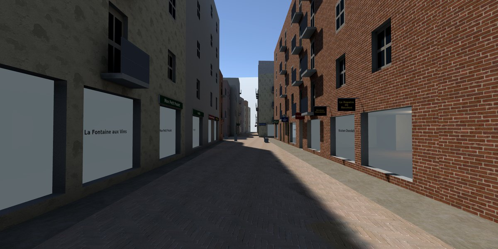
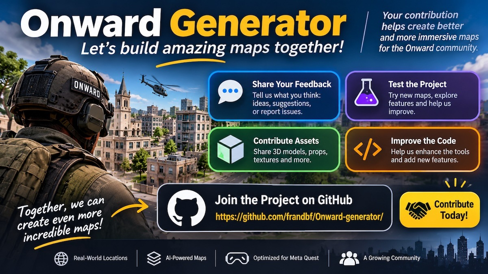
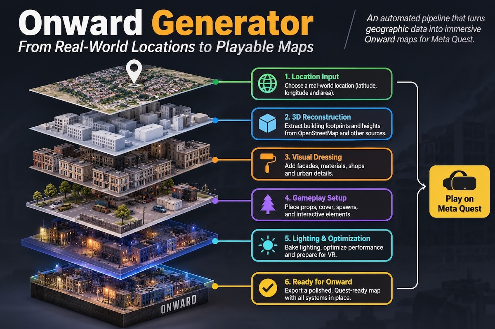

# onward-generator

**Turn any street on Earth into a playable map for Onward on Meta Quest.**

Give it a name, a latitude and a longitude. It downloads the real streets and buildings around that point from OpenStreetMap, builds them in 3D with facades, shops, signs and props, and hands the result to Unity and the Onward SDK, which build a map you can upload to your headset and play: Free Roam, Hunt with bots and Uplink.


https://github.com/user-attachments/assets/f9b6bdb2-62bd-4099-a8c0-4557d05f55ac


## See it in action

| Play it | Make it |
| --- | --- |
| [](https://www.youtube.com/watch?v=uXA0cxPk-ow) | [](https://www.youtube.com/watch?v=tIMqPV8vhio) |
| **A map of France**, played on Meta Quest | **The console**: one command builds a map of Murcia |
| [](https://www.youtube.com/watch?v=zvScGjAt99Y) | [](https://www.youtube.com/watch?v=4IqQvhWIAZM) |
| **Murcia**, played on Meta Quest | **Unity**: the map, just generated, opened in the editor |

## What it does



*Rue Mouffetard, Paris (48.84045, 2.34981, 50 m radius), with its real shop names. Unity editor render of the baked scene. Map data © OpenStreetMap contributors, IGN LiDAR HD, Overture Maps Foundation.*


- **Real places, any city.** Streets, footprints and names come from OpenStreetMap. Better data is added where it exists: building heights from LiDAR in France and Spain, Catastro buildings and shop uses in Spain, Overture Maps places everywhere.
- **Streets you can fight in.** Each building gets windows, doors, balconies, roofs and walk-in shops with their real names on the sign. Street plates, benches, lamps, trees and, if you ask, an abandoned-city layer of wrecks and overgrowth.
- **A complete Onward map.** Spawns, Hunt patrol routes and bots, Uplink, ladders and lifts to the roofs, a perimeter wall, a horizon, baked lighting and a navmesh, all made for you.
- **Runs on your machine.** No cloud service. AI is optional: a local [Ollama](https://ollama.com) model can choose textures and props; without it, deterministic rules do.
- **Honest about its sources.** Every building is one the data contains, every attribute is marked observed, estimated or generated, and every licence is recorded.

**Status:** version 0.1.0, experimental. Generated maps build and play on a Quest 3. On 5 November 2026 the Paris map above loaded in 2.9 s and ran a Hunt match with bots at a median of 73 fps, with short dips while the bots spawned ([measurements](docs/09-perf.md#hunt-with-bots-on-a-small-map)). The formal headset checklist (`quest_acceptance.md`) is still open, so packages say `device_verified: false`.

## Try it

You need:

- macOS (tested on an Apple M4 Pro) or Linux;
- [Docker](https://www.docker.com) and [go-task](https://taskfile.dev);
- Unity **2021.3.23f1** and the Onward Custom Content SDK v1.15 package;
- a Meta Quest in developer mode, connected by USB, to play the map.

**1. Prepare Unity, once.** Put the SDK at `~/Unity/OnwardSDK/OnwardCustomContent_SDK_v1.15.unitypackage`, then run:

```bash
tools/unity/phase0_room/run_phase0.sh create import patch tool xr configure
```

This creates `~/Unity/OnwardPhase0Project` and sets it up for the SDK. Open that project only with 2021.3.23f1, and close the editor before building a map.

**2. Generate a map.** Pick a point: on [openstreetmap.org](https://www.openstreetmap.org) the address bar holds the centre of the view, `#map=19/<lat>/<lon>`. Start small:

```bash
task map -- --name "Rue Mouffetard" --lat 48.84045 --lon 2.34981 --radius-m 100
```

The first call builds the Docker image. Then every Python stage runs in the container and prints one line, ending with the time and the warnings (from the Paris map above):

```text
 [ 8/16] detail     1.5 s  46 375 tris  39 mat  171 nodes
 [ 9/16] dress      1.3 s  trees 16-side x3  atlas on
 ...
 [16/16] export     0.7 s  paris_contrescarpe_0bb0ba4a50  per view 76 median, 177 p90, 183 max
✓ Python 27.6 s  (map setup 38.6 s)  67 warnings
```

**3. Build it and play it.**

```bash
task unity
```

Unity builds the newest package: it imports the meshes, bakes the lighting and builds the Onward bundle. Then it asks `¿Subir al Quest? [s/N]`. Answer `s` to back up the headset's local map and replace it with yours. In Onward, open the custom maps and pick **Unity Export**.

**How long it takes** (measured on an Apple M4 Pro, 5 November 2026):

| Map | Python, with map setup | Unity, `final` bake |
| --- | --- | --- |
| Barcelona Sarrià, 150 m radius, 10 texels/m | 3 min 48 s | 4 min 47 s, of which 3 min 16 s lighting |
| Paris, 50 m radius, 40 texels/m | 1 min 06 s | 19 min 06 s, of which 17 min 16 s lighting |

Map setup, which creates the folder and downloads OpenStreetMap, took 54 s and 39 s of that. Lighting time grows with the area and with the square of the texel density: the small Paris map at 40 texels/m bakes 24 lightmap pages, Barcelona at 10 bakes 5. `task unity` bakes the faster `draft` profile by default; use `ONWARD_BAKE=final task unity` for the map you publish.

## Make it yours

| Option | What it does |
| --- | --- |
| `--radius-m 50…1500` | Half the side of the square, in metres (default 125, which leaves a 100 m playable core inside a 25 m scenic ring). On an existing map `run` uses the radius in `map.json`. |
| `--core-radius-m` | The playable core. Past it, buildings are plain shells, so large maps stay inside the Quest budget ([ADR-017](docs/decisions/ADR-017-playable-core.md)). |
| `--lightmap-texels-per-m` | Lighting detail, at most 40 (default 10). Higher looks sharper and bakes much longer. |
| `--brief "…"` | How the streets should feel. Ask for an abandoned city and cars and barrels block the road. |
| `--ai` | Ask local Ollama for the prop plan; a rejected answer falls back to the rules. |
| `--no-source <id>` | Switch off a data source; `onward-generator source list` shows them. |
| `--time-of-day night` | A night map, lit by the street lamps ([ADR-026](docs/decisions/ADR-026-time-of-day.md)). |
| `--atmosphere golden_hour` | A light preset for a day map, `golden_hour`, `overcast` or `dusty` (a warm muted sun, a close sand-coloured haze, dirtier walls): sun, ambient, fog and wall palette. `golden_hour` doubles the bounced light so a soldier in a narrow shaded street stays readable ([ADR-037](docs/decisions/ADR-037-atmosphere-presets.md)). |

`task unity -- "Map name"` builds a map other than the newest one. Every command and flag is in [docs/commands.md](docs/commands.md).

### Project wall decals

Every map carries the project's nine wall decals from `assets/decals/` (stencil plates and signs such as *From OpenStreetMap to open warfare* and *Open source, open fire*; MIT), each once on a wall of the playable core. `map.json` `"project_decals": false` leaves them out of a map.

### Your own wall decals

Put PNG images (with a transparent background where the decal is not a rectangle, at least 400 px on the long side) in `assets/user_decals/`, a local folder that is never committed, and list them in `assets/user_decals/decals.json` with their size on the wall in metres (`width_m` or `height_m`, 0.2 to 3 m):

```json
{"decals": [{"file": "mural.png", "width_m": 1.2, "description": "A mural from my street"}]}
```

Every map then carries each of them once, on an exposed wall of the playable core, before the generated decals; a decal that fits no wall stops `signs place` with its name. A map for the Onward Workshop must not show real people (Custom Content Guide): set `"user_decals": false` in its `map.json` to leave them out. Use only photographs you may share: no recognisable people, brands or personal data ([ADR-038](docs/decisions/ADR-038-wall-decals.md)).

### Every option

A new map gets the base pipeline: OSM, the height sources that cover its centre, trim-sheet facades in the style of its region, the playable core in a 25 m scenic ring, furnished shops and flats, library lamp posts and cut-out trees when your local catalogues hold them, the rule-based dressing, the Hunt layout and the `neutral` light. Since 13 November 2026 it also has every `map.json` switch below on, except Panoramax; `--no-<switch>` turns one off. Most of them are proposed until a headset session validates them; a map created before keeps the switches its `map.json` lists.

**Switches of `map create` and `run`** (stored in `map.json`; on for a new map unless marked off; on an existing map, set the key and rerun from the stage it feeds):

| Flag | `map.json` key | What it adds |
| --- | --- | --- |
| `--atmosphere golden_hour`, `overcast` or `dusty` (off: `neutral`) | `atmosphere` | Light preset of a day map: sun, ambient, AO, fog colour, wall palette; `golden_hour` doubles the bounced light ([ADR-037](docs/decisions/ADR-037-atmosphere-presets.md)) |
| `--repetition` | `repetition` | Calm roof and paving pools and a per-cell ground phase, less visible tiling (plan C1) |
| `--overture-tints` | `overture_tints` | Facade tints from Overture building colours where OSM has none (plan C2) |
| `--lidar-roofs` | `lidar_roofs` | Flat or pitched roofs from the LiDAR nDSM where OSM has no roof tag (plan C3; needs a LiDAR source: `es.pnoa_ndsm`, `fr.lidar_hd`) |
| `--regional-facades` | `regional_facades` | Regional trim atlases for `central_european`, `anglo`, `latin_american`, `haussmann`, `east_african` and `arid` (plan D1) |
| `--street-profile` | `street_profile` | Local Ollama picks a street profile (facade style, palette, props, abandonment, cover) that code turns into stage flags (plan D2) |
| `--ai` (off unless asked) | `ambient_ai` | Local Ollama picks the props and wall decals; a rejected reply keeps the rules ([ADR-010](docs/decisions/ADR-010-overgrow-ai-plan.md)) |
| `--panoramax` (off) | `panoramax` | Under development: 360° street photos projected onto exposed facades |
| `--panoramax-atlas` (off) | `panoramax_atlas` | With `--panoramax`: one decal image per combine cell, tinted trim walls, coverage report |
| `--gameplay-report` | `gameplay_report` | `gameplay_report.json`: routes, sightlines, contact balance ([ADR-032](docs/decisions/ADR-032-gameplay-metrics.md)) |
| `--balanced-spawns` | `balanced_spawns` | Spawns and Uplink chosen by the gameplay metrics (plan C6) |
| `--sightline-cover` | `sightline_cover` | Solid cover props on open sightlines past 60 m (plan C7) |
| `--wide-library` | `wide_library` | 25 more CC0 Poly Haven photo textures (plan T1) |
| `--normal-maps` | `normal_maps` | Real relief on ground, roofs and bark: `PP_Opaque_Lit` with the photographs' CC0 normal maps ([ADR-039](docs/decisions/ADR-039-library-normal-maps.md), accepted) |
| `--texture-variants` | `texture_variants` | Two more calm photographs for roofs and plaster walls, one per building (plan T4) |

`--street-profile` and `--ai` need [Ollama](https://ollama.com) with `qwen3:14b`; without it they fall back to rules. In Docker on macOS the container reaches it as `host.docker.internal` on its own.

**Night instead of a preset:** `--time-of-day night` (lit by the street lamps, [ADR-026](docs/decisions/ADR-026-time-of-day.md)) and `--storm` (lightning and thunder). A night map refuses every `--atmosphere` but `neutral`.

**Size and core:**

| Option | What it does |
| --- | --- |
| `--core-target-triangles N` | Budget core: the core half-side is solved for N core triangles instead of a fixed radius ([ADR-017](docs/decisions/ADR-017-playable-core.md) amendment) |
| `map.json` `"mid_ring_m": W` | 10 to 1000 m of intermediate HLOD ring around the core (plan D3) |
| `map.json` `"facades": {"mode": "trim" \| "legacy", "style": "<name>" \| "auto", "weathering": "clean" \| "worn" \| "heavy"}` | Force a facade style, the old per-material facades, or aged walls |
| `map.json` `"triangle_limit": N` | 100 000 to 300 000 (default 300 000): what props and library trees fill up to and what the package is checked against; 250 000 for the Onward Workshop ([ADR-005](docs/decisions/ADR-005-quest-performance.md) amendment) |
| `map.json` `"user_decals": false` | Leaves your own wall decals (*Your own wall decals* above) off this map, as a Workshop map must |
| `map.json` `"project_decals": false` | Leaves the project's wall decals (`assets/decals/`) off this map |
| `map.json` `"damage": "none" \| "light" \| "heavy" \| "auto"` | War damage on the walls and decals on the ground of the core; rerun from `signs` ([ADR-038](docs/decisions/ADR-038-wall-decals.md) amendment) |
| `map.json` `"overhead_lines": true \| false` | Poles, wires and service drops along the streets; absent, an `east_african`, `arid` or `latin_american` map gets them and the others do not; rerun from `overgrow` ([ADR-045](docs/decisions/ADR-045-overhead-lines.md), proposed) |
| `map.json` `"street_mood": "lived" \| "emptied"` | A street in daily use (no growth or wrecks, intact props, street furniture, café terraces under parasols before the bars of pedestrian streets, awnings over the shop windows, no war wear on the walls) or one emptied days ago; absent is `abandoned`, unless the street profile offers a mood from the brief; rerun from `signs` ([ADR-044](docs/decisions/ADR-044-street-moods.md), proposed) |
| `map.json` `"smoke": N` | 0 to 5 smoke columns over wrecks of the core; rerun from `export` ([ADR-043](docs/decisions/ADR-043-smoke-columns.md), proposed) |

**Data sources:** `--source nl.ahn` and `--source de.nrw_ndom` are opt-in LiDAR heights, used only inside their coverage. `onward-generator source list` shows every source; `--no-source <id>` turns one off.

**Export card** (`maps/<id>/config/export.json`, keys under `build`, [docs/12-export.md](docs/12-export.md)):

| Key | What it does |
| --- | --- |
| `scenic_out_of_lightmap: true` | Scenic shell walls leave the lightmap (plan C4) |
| `lightmap_pages_max: N` | Lowers the texel density until the lightmap fits N pages, never below 4 texels/m (plan C5) |
| `lit_normal_material: "facade_trim_…"`, `lit_normal_strength` | Spike: one facade material lit with a derived normal map ([ADR-033](docs/decisions/ADR-033-lit-normal-spike.md)) |

**Build and headset:** `ONWARD_BAKE=final task unity` bakes the final lighting (default `draft`). `ONWARD_QUEST_LISTING=local-thumb`, `named` or `named-thumb` try experimental card listings ([docs/12-export.md](docs/12-export.md#quest-listing-modes-experimental)). `task unity` asks before every upload. To share a map on the Onward Workshop, check it against the guide first and publish it from a Windows PC: [docs/12-export.md](docs/12-export.md#onward-workshop).

**On by default, can be turned off:** shop furnishing (`interiors.shops.furnish.enabled`), flat furnishing (`interiors.furnish.enabled`), semantic furniture sets (`ONWARD_SEMANTIC_SETS=0` off) and your local Asset Store catalogues (`ONWARD_LOCAL_CATALOGUES=0` hides them).

A name, a centre and a radius are enough; every switch above that is not marked off comes on by itself:

```bash
onward-generator run --name "My map" --lat 48.84045 --lon 2.34981 --radius-m 125
```

Turn a switch off with its `--no-` flag, on `map create` or on `run` for a new map, for example `--no-normal-maps` or `--no-texture-variants` ([docs/02-configuration.md](docs/02-configuration.md)). A map created before keeps the switches its `map.json` lists. With `--regional-facades` a map in Paris gets light limestone Haussmann facades; Kraków, London or Mexico City get their own regional atlas ([docs/08-dress.md](docs/08-dress.md#trim-sheet-facades)).

**If something goes wrong:**

- **A stage fails.** The console prints `FAILED` and the stage to resume from. Run the same command again: finished stages are skipped.
- **Overpass is busy.** It is retried on its own. If it still fails, run `onward-generator osm download --map maps/<id>`.
- **Unity is open.** The build asks you to close the editor first.
- **Check your setup.** Run `tools/docker/run.sh onward-generator doctor`. It is read-only: a missing Unity, `adb` or SDK is a warning.
- **The AI stages fall back to rules.** Ollama is not running, or the model is missing. On macOS the container reaches the Mac's Ollama as `host.docker.internal` on its own ([docs/10-ai.md](docs/10-ai.md#providers-and-privacy)).
- **Latitude and longitude** are WGS84 decimals. A negative longitude uses the keyboard hyphen (`-3.65288`).

Each map lives in `maps/<id>/`, the name in lower case with `_` between words. An export package is never overwritten: the next build of the same map is `pkg_02`. The headset has one local map slot, so its card is always called `Unity Export`; experimental listing modes try to show the map's own name and picture ([docs/12-export.md](docs/12-export.md#quest-listing-modes-experimental)).

## With Claude Code

If you use [Claude Code](https://claude.com/claude-code), the project skill in `.claude/skills/onward-generator/` lets you make maps by describing them: the place, the size, how it should feel. It runs only the `task` commands above, in Docker, asks before anything slow, explains failures in plain words, and walks you through the Quest upload and the Onward Workshop rules. It never uploads to your headset or edits the code.

## Without Docker

With Python 3.12 or newer (tested with 3.14):

```bash
python3 -m venv .venv
.venv/bin/python -m pip install --only-binary=:all: -r requirements.lock
.venv/bin/python -m pip install --no-deps -e .
.venv/bin/onward-generator run --name "Rue Mouffetard" --lat 48.84045 --lon 2.34981 --radius-m 100
```

The editable install is required: the code finds `config/` and `assets/` relative to the repository. `run` does everything `task map` and `task unity` do, in one command.

## How it works

`map` → `geo` → *source plugins* → `heights` → `generate` → `detail` → `dress` → `materials` → `signs` → `overgrow` → `fit` → `bounds` → `layout` → `export` → Unity → Quest

Each stage reads the previous stage's output and writes a new folder, so nothing is overwritten and any stage can be run again on its own. The same input and seed give the same map. A GLB is not a playable map: only the Unity adapter and the Onward SDK make one.

## Documentation

| Read | For |
| --- | --- |
| [docs/01-pipeline.md](docs/01-pipeline.md) | The whole pipeline, what to rerun after a change, and every stage by hand. Start here. |
| [docs/02](docs/02-configuration.md) to [docs/08](docs/08-dress.md) | Configuration, geography, heights, Catastro, base meshes, facades and detail, textures. |
| [docs/09-perf.md](docs/09-perf.md) | Measuring a map on the headset. |
| [docs/10-ai.md](docs/10-ai.md) | The optional local AI. |
| [docs/11-onward-sdk.md](docs/11-onward-sdk.md), [docs/12-export.md](docs/12-export.md) | The Onward SDK rules, and the Unity build, bake and upload. |
| [docs/commands.md](docs/commands.md) | Every command, its flags and exit codes. |
| [docs/decisions/](docs/decisions/) | Why each design choice was made, one record per choice. |
| [docs/abandoned-assets.md](docs/abandoned-assets.md) | The props the abandoned-city layer can place, with a picture of each. |
| [docs/legal/data-sources.md](docs/legal/data-sources.md) | Licences, attribution and ODbL obligations. |
| [docs/plans/](docs/plans/) | Measured studies and work plans, in Spanish. |

The documentation is in English.

## Contributing

[](CONTRIBUTING.md)

- **Share your feedback.** Ideas, suggestions and bugs go to the [issues](https://github.com/frandbf/Onward-generator/issues). A map that looks wrong is most useful with its name, centre and radius.
- **Test the project.** Build a map of a street you know with [Try it](#try-it) and tell us how it plays on the headset.
- **Contribute assets.** 3D models, props and textures join a catalogue under `assets/`, each with its licence recorded ([docs/legal/data-sources.md](docs/legal/data-sources.md), [docs/abandoned-assets.md](docs/abandoned-assets.md)).
- **Improve the code.** [CONTRIBUTING.md](CONTRIBUTING.md) covers the development setup, the tests and the quality gates; [AGENTS.md](AGENTS.md) holds the working rules for every change. In short: `task ci` runs what CI runs, and a change is ready when `task ci` and `task mutate` pass.




## Data and licences

- OpenStreetMap data is ODbL-1.0. A map built from it keeps the attribution `© OpenStreetMap contributors`, which the generator writes in the package and on the map's card.
- Catastro INSPIRE BU (Spain only) and the IGN MDSn (Spain) are CC BY 4.0; IGN LiDAR HD (France) is Licence Ouverte 2.0; Overture places are CDLA-Permissive-2.0, Apache-2.0 or CC0-1.0 per record, and a place under any other licence is dropped.
- Every texture, prop and font in `assets/` records its licence. The signs are generic: they show a shop's name, never its real logo.
- Generated maps (`maps/`) are local work and are not committed. Neither are credentials, the Onward SDK or large source extracts.

Details: [docs/legal/data-sources.md](docs/legal/data-sources.md). This project is not affiliated with Downpour Interactive.

## License

onward-generator is free and open source under the [MIT License](LICENSE): use it, change it, ship it, even commercially. Keep the copyright line and the licence with your copy, and that is all the licence asks.

**Grow it with us.** These are requests, not conditions, and they are how the project gets better for everyone:

- **Send your improvements back.** A fix, a data source for your country, a better facade, a faster bake: open a [pull request](https://github.com/frandbf/Onward-generator/pulls), even a small or rough one.
- **Show what you build.** Share your map, a video or a bug in the [issues](https://github.com/frandbf/Onward-generator/issues).
- **Credit the project.** A line such as *Made with [onward-generator](https://github.com/frandbf/Onward-generator)* in a map description, a video or a fork helps other people find it and join in.

[NOTICE](NOTICE) has the details:
- **Other licences:** the documentation is CC BY 4.0, and `assets/` keeps the licence of each author.
- **Maps:** the licence does not cover the maps you generate; their data licences, OpenStreetMap's above all, still apply.
