# Pipeline — create and revise a map

Read the numbered files in `docs/` in order. This is `01`. `02` is configuration, then each stage through `12` (export). `abandoned-assets.md` is the prop catalogue. `legal/data-sources.md` is the licence record. Files in `decisions/` explain a choice. They are not the next chapter.

Process contract. The command is `onward-generator` (`python -m onward_generator`). Murcia (Belluga, latitude 37.98407, longitude −1.12863, `MURCIA_CENTER` in the tests) is the test origin, not the name of the tool.

Phase 07 stays **open**. `device_verified` is false until `quest_acceptance.md` is filled in on the headset (`docs/12-export.md`). This document does not authorise `CONFIRM_PUSH`.

## Rules

A stage is independent when it:

- reads only the immutable output of the previous stage (manifest plus SHA-256);
- writes a **new** directory;
- refuses to write when the input hash does not match;
- does not import Unity or the SDK. The exceptions are `export` and the Onward Launcher.

`geo`, `generate`, and `detail` are deterministic: the same input and the same seed produce the same bytes.

No command overwrites without `--overwrite`. An export package is **never** overwritten. If the folder exists, `export package` refuses. Unity also refuses to rebuild a scene or a launcher whose output directory already exists.

## Order

Stage 0 prepares the Unity project once. It is not repeated per map.

Each box is a new directory. Dashed boxes are optional. `detail` reads the original `generate`. The wall is added at the end, on the dressed copy, and that copy is what `export` reads.

```mermaid
flowchart LR
  mapCreate[map create] --> osm[Overpass from lat/lon]
  osm --> geo[geo]
  geo -.-> catastro[catastro download]
  catastro -.-> cadastre[cadastre split]
  cadastre -.-> overture[overture fetch + match]
  overture -.->|secondary overrides| heights
  overture -.->|places| detail
  cadastre -.-> plugins[other source plugins]
  plugins -.-> merge[source merge]
  cadastre -.-> heights
  merge -.-> heights
  geo --> heights[heights]
  heights --> generate[generate]
  generate --> detail[detail]
  detail --> dress[dress style]
  dress --> props[props place]
  props --> materials[materials apply]
  materials --> gate{panoramax}
  gate -->|false| signs[signs place]
  gate -->|true| pano[panoramax apply]
  pano --> signs
  signs --> overgrow[overgrow place]
  overgrow --> fit[overgrow fit]
  fit --> bounds[bounds]
  bounds --> layout[perf layout --playable]
  layout --> exportPkg[export package]
  layout -.-> cover[perf cover]
  cover -.-> exportPkg
  exportPkg --> unity[Unity]
  unity --> quest[Quest]
```



`dress style`, `props place`, and `materials apply` can be skipped. If they are skipped, `bounds` reads `detail` directly. The dashed source stages come from source plugins (ADR-018): `run` adds the stages of every registered plugin that covers the map centre and is not switched off (`run --no-source <id>`), and prints them on a `sources` line. An opt-in plugin (plan D4, ADR-018 amendment of 9 November 2026) also needs `run --source <id>`; a covering one without that switch is named in `(opt-in: …)` and adds nothing. `onward-generator source list` shows the plugins. `catastro` and `cadastre` (`es.catastro`) run by default in the territories the DG Catastro WFS serves (`docs/05-cadastre.md#coverage`); `run --no-catastro` skips them. Then `heights` and every later stage read `data/processed/cadastre/geo_scene.json`, where block footprints are split into one building per Catastro construction (ADR-016). In Spain (Navarre and the Basque Country included, Ceuta and Melilla not) `es.pnoa_ndsm` adds `pnoa_ndsm` (`source fetch`, network) and `pnoa_heights` (`source normalize`), measured on the split scene ([04-heights.md](04-heights.md#lidar-heights)). In metropolitan France and Corsica `fr.lidar_hd` adds `lidar_hd` and `lidar_hd_heights` (`config/lidar_hd_coverage.json`). In the Netherlands, only with `run --source nl.ahn`, `nl.ahn` adds `ahn` and `ahn_heights` (`config/ahn_coverage.json`). In North Rhine-Westphalia, only with `run --source de.nrw_ndom`, `de.nrw_ndom` adds `nrw_ndom` and `nrw_heights` (`config/nrw_coverage.json`). In the municipality of Madrid, only with `run --source es.madrid_lod2` (plan D6), `es.madrid_lod2` adds `madrid_lod2` (`source madrid-lod2`, network): the LoD2 block ZIPs under the scene's landmarks and `data/raw/madrid_lod2/lod2_index.json`, which `detail` reads with `--lod2-landmarks` ([07-detail.md](07-detail.md#lod2-landmarks), `config/madrid_coverage.json`); it writes no overrides. When more than one plugin writes height overrides, `overrides` (`source merge`) ranks them by `config/sources.json` `priority` into `data/processed/sources/heights_overrides.json`, and `heights` reads that file. The `overture` plugin (ADR-021) covers every city: `overture` (fetch, network) and `overture-match` run after the plugins that write a scene; `run --no-source overture` skips them. Its height overrides do not join the merge: `heights` reads them with `--secondary-overrides`, below an OSM `height` and the merged overrides, and `detail` reads its places with `--places`. `panoramax apply` runs only when `map.json` has `"panoramax": true`. A map with the key absent, or with the key `false`, keeps the order above with `signs` reading `scene_materials`. `overgrow fit` is not skipped. If a prop is the wrong size or in the wrong place, `bounds` does not start. `perf cover` runs only when `map.json` has `"sightline_cover": true` (plan C7, [Sightline cover](#sightline-cover-off-by-default)); `export` then reads its `scene_covered` copy instead of `scene_playable`.

## 0. Unity project — once

This is the project `export` and the Onward Launcher use. It lives in `~/Unity/OnwardPhase0Project`. Maps in this repository are not inside that folder.

| Setting | Value |
| --- | --- |
| Editor | Unity 2021.3.23f1. A newer editor rewrites the project and 2021.3 can no longer open it |
| URP | `com.unity.render-pipelines.universal` 12.1.11 |
| Burst | Installed. The SDK `NavigationMapValues` uses `BurstCompile` |
| Pipeline | In Graphics, `Assets/OnwardCustomContent/UniversalRenderPipelineAsset` (guid `7decc6ad7e4538047bac43b16df38ce6`). All six quality levels inherit it |
| Colour | Linear |
| Shader stripping | Lightmap Modes and Fog Modes on Custom, every lightmap and fog checkbox on |
| Android | Active platform, IL2CPP, ARM64 |
| XR | XR Plugin Management 4.5.2 and Oculus XR Plugin 3.3.0. Oculus on for PC and Android. PC: Single Pass Instanced. Android: Multiview |
| Launcher path | In `OnwardLauncher.cs`, only `.Replace('/', '\\')` is removed. Needed on macOS and Linux. The SDK original stays outside `Assets`. Reimporting the `.unitypackage` undoes the patch |
| Navigation map | The Quest reads the `AI_NavBake` JSON, not the `NavigationMap` object. `tool` applies `patch_content_builder.py`. Reimporting the package undoes it. The next `tool` puts it back |
| Graphics API | The project leaves it on automatic. When the scene is built, the adapter sets Vulkan, with OpenGLES3 as fallback |

The SDK package is `~/Unity/OnwardSDK/OnwardCustomContent_SDK_v1.15.unitypackage`. `ExampleScene` is not renamed, and the `OnwardCustomContent` prefabs are not edited. Playable-map detail is in [11-onward-sdk.md](11-onward-sdk.md).

`scene` opens that project in batch mode. If the Editor already has it open, the step cannot start. Before the first stage, `onward-generator run` checks that lock: an exclusive hold on `Temp/UnityLockfile`, or `Library/EditorInstance.json` when its process is still alive. A terminal tells the user to close the Editor and waits for `s` or `si`. The stages start only after that answer and only once the project is closed. Any other answer cancels the run. A terminal that cannot ask stops with `FAILED unity` and does not start the stages. A freshly created project does not contain `Assets/OnwardAdapter/`.

## Host platform

The Unity, adb, log, and Asset Store cache paths depend on the host. The host is macOS or Linux. It is chosen by a flag or a variable, never by editing a path. Decision: [ADR-011](decisions/ADR-011-host-platform.md).

1. `--platform macos|linux|auto`. It goes before the command (`onward-generator --platform linux run ...`) and is also accepted by `run`. The Unity scripts take it as their first argument (`run_export.sh --platform linux PACKAGE_DIR ...`). `auto` counts as not given.
2. The `ONWARD_PLATFORM` variable. The global flag sets it, so every child process sees the same host.
3. Detection: `platform.system()` in Python, `uname -s` in the scripts. `Darwin` is macOS, `Linux` is Linux.

Any other value, or another system, is a usage error (exit `2`). It is never ignored. `doctor` reports it as a failed `host:platform` check. After the host is chosen, `UNITY`, `ADB`, `LOG_ROOT`, and `ASSET_STORE_CACHE` still override one path each, and `LOG_DIR` still overrides one script's log folder. `doctor` checks the same paths: `onward:unity_editor` shows the Unity executable (on macOS `.../Unity.app/Contents/MacOS/Unity`, not the `.app` bundle) and `onward:adb` the adb binary, and both honour `UNITY` and `ADB`. `onward-generator platform [--json]` prints the result.

| | macOS | Linux |
| --- | --- | --- |
| Unity executable | `/Applications/Unity/Hub/Editor/2021.3.23f1/Unity.app/Contents/MacOS/Unity` | `~/Unity/Hub/Editor/2021.3.23f1/Editor/Unity` |
| adb | `/Applications/Unity/Hub/Editor/2021.3.23f1/PlaybackEngines/AndroidPlayer/SDK/platform-tools/adb` | `~/Unity/Hub/Editor/2021.3.23f1/Editor/Data/PlaybackEngines/AndroidPlayer/SDK/platform-tools/adb` |
| `LOG_ROOT` | `~/Library/Logs` | `${XDG_STATE_HOME:-~/.local/state}/onward-generator` |
| Asset Store cache | `~/Library/Unity/Asset Store-5.x` | `~/.local/share/unity3d/Asset Store-5.x` |

The macOS values are the ones used before the option existed. The Linux values are the Unity Hub defaults. They have not been checked on a Linux host with Unity installed. `run` passes `ONWARD_PLATFORM`, `UNITY`, `ADB`, and `LOG_ROOT` to `run_export.sh`. The scripts share `tools/unity/lib.sh`, which also picks `md5 -q` or `md5sum` and `shasum -a 256` or `sha256sum` by which tool is installed, not by the platform name.

## What to rerun

| What changed | Run again | Keep |
| --- | --- | --- |
| Centre, radius, or card name | `map create` and, if the area changed, everything from `geo` | the other maps |
| OSM extract | `geo` and everything after it | the map folder |
| Catastro split | `cadastre` (or `catastro` for a new download), then `heights` and everything after it | `geo` |
| Overture places or heights | `overture-match` (or `overture` for a new download), then `heights` and everything after it | `geo`, Catastro |
| Heights, Catastro or another source plugin | the plugin's stages and `overrides` when it runs, then `heights`, `generate` and everything after it | `geo` |
| Volumes | `generate` and everything after it | `geo`, `heights` |
| Facades | `detail` and everything after it | `generate` |
| Generated trees and benches | `dress style` and everything after it | `detail` |
| Asset Store instances | `props place` | the `detail` geometry |
| Textures | `materials apply` | geometry and OSM footprints |
| Street photos | `panoramax apply`, under development, only when `map.json` has `"panoramax": true` | collision, roofs, interiors, and buildings without a photo |
| Street name, shop signs | `signs place` on the dressed copy (where a sign goes and its name come from `detail`) | the carriageway and the facades |
| Abandoned city | `overgrow place`, then `overgrow fit` | building footprints and the drive lane |
| Perimeter wall | `bounds` on the dressed copy, then layout and export | `generate` and `detail` |
| Spawns, routes, modes | `perf layout --playable` and a new package | the geometry |
| Sightline cover (`"sightline_cover": true`) | `perf cover` after the layout, then a new package | `scene_playable` and the layout |
| Lightmaps or shader | Unity on a **new package** | the input package |

## 1. Map folder

`onward-generator map create`. Configuration: [02-configuration.md](02-configuration.md).

| | |
| --- | --- |
| Input | `--name` (1–80). The id and `maps/<id>` are that name in lower case, without accents, spaces as `_`. `--lat`, `--lon` (WGS84 decimals; a negative value takes the keyboard hyphen, `-3.65288`, and a typographic minus is rejected), `--radius-m` (50–1500, default 400), `--margin-m` (default 30), `--lightmap-texels-per-m` (greater than 0 and at most 40, default 10), `--core-radius-m` (default `min(150, radius − 50)`, none under a 100 m radius; 0 or at least the radius plays the whole map, otherwise at least 50), `--core-target-triangles` (optional, 1000 to 2 000 000: the budget core, below) |
| Output | `map.json`, `config/project.json`, `config/export.json`, `config/texture_plan.json`, `reference/aoi.geojson`, `data/raw/<id>.osm` |
| Area | A square in local metres around the centre, converted to WGS84. Degrees are not treated as metres |
| CRS | EPSG:25830 when the centre is in peninsular Spain. Otherwise the WGS84 UTM zone of that point (north `EPSG:326xx`, south `EPSG:327xx`). Stored in `map.json`. `map show` prints the `--crs` that `geo` must use |
| OSM | One Overpass request for the square plus the margin: every node and way in the box, and only the `type=multipolygon` relations, which are the only ones `geo` assembles. A route relation would bring its whole bus or tram line from outside the area. Writes `data/raw/<id>.osm` and a `.source.json` whose `relation_types` names the relation types asked for; an extract written before this filter has no `relation_types` and holds every relation, and `geo` still reads it. Does not replace an extract that is already there unless `--overwrite` |
| Textures | One plan for this map, chosen from the imported library. See below |
| Does not | Generate geometry. It does not pick a global "active" map |

`onward-generator run` walks the chain from `--name`, `--lat`, and `--lon`. `--brief` stores how the city should feel. If the sentence asks for an abandoned city, chaos, or blocked streets, `overgrow` leaves a few cars and barrels on the carriageway. Otherwise they stay on the kerb. `--ai` stores `ambient_ai`, and `overgrow` asks Ollama for a gesture plan. If it does not answer or the JSON does not validate, it retries once. If that attempt also fails, the rules place the props. `--panoramax` stores `panoramax`. It is written only when the argument is present, the same way as `--ai`. A later run without the flag does not turn it off. Absent on an older `map.json` means off. `--street-profile` stores `"street_profile": true` the same way (plan D2, off by default). Before it plans the stages, `run` then asks local Ollama for a street profile: one enumerated id each for the facade style, the palette, the props, the abandonment years and the cover count, never a value. Code turns each id into an existing stage flag (`materials --facade-style` or `--repetition`, `overgrow --profile` or `--selection`, `perf cover --max-props`) and stores the reply, its hashes and the changes in `config/street_profile.json`; a later run with the same inputs replays it without calling the model, and a failed or missing model leaves the neutral profile, which changes nothing. See [10-ai.md](10-ai.md#street-profile-plan-d2). Freshness goes by file age, so after a new profile rerun from `materials` (`run --from materials`).

`run` prints a header with the map name, folder, centre, radius, margin and lightmap density. Map setup (`map create` and `osm download`) has no numbered row. Each Python stage then prints one line: its number, name, duration and key numbers. Those numbers come from the report JSON the stage wrote under its `--out` (`geo_report.json`, `heights_report.json`, `generation_report.json`, `detail_report.json`, `materials_report.json`, `panoramax_report.json`, `signs_report.json`, `overgrow_report.json`, `fit.json`, `bounds_report.json`, `layout.json`, `onward_export.json`), not from its printed text. A breakdown (openings, urban elements, overgrow growth, skipped materials) goes on indented lines, as `key count` sorted by count and wrapped at about 100 columns. Thousands are grouped with a space. A non-zero `critical` or `warning` severity, a geo error or warning, or an export warning goes on its own line that starts with `!`, red for errors and yellow for warnings. The standing `export_adapter_unverified` warning is not repeated. Colour is used only on a terminal and never when `NO_COLOR` is set. The last line gives the Python time, the map setup time and the warning count, then `→ Unity:` names the Unity steps still missing. `--verbose` adds each stage's full output under its line. File paths, the package listing, the layout JSON, and the full Unity log stay out of that summary.

```
Paris Contrescarpe  maps/paris_contrescarpe
48.84044803797855, 2.3498059975093395  r 50 m  margin 30 m  lightmap 40 t/m

sources  fr.lidar_hd, overture  (not here: es.catastro, es.pnoa_ndsm, nl.ahn, de.nrw_ndom)
 [ 1/16] geo        0.1 s  EPSG:32631  kept 453  dropped 87
 [ 2/16] lidar_hd   6.0 s  566 KiB  1 tile  etalab-2.0
 [ 3/16] lidar_hd_heights  0.1 s  measured 60/65  2.67–23.43 m
 [ 4/16] overture  13.9 s
 [ 5/16] overture-match  0.0 s  places 68 of 160  heights 0 of 65
 [ 6/16] heights    0.0 s  65 buildings  measured 92.31%  inferred 7.69%
 [ 7/16] generate   0.2 s  4 538 tris  3 492 collision  9 mat
 [ 8/16] detail     1.5 s  46 375 tris  39 mat  171 nodes
         openings   window 959, balcony 436, balcony_door 436, narrow_window 298, shopfront 216,
                    interior_door 45, door 12, shop_door 5, landmark_door 1
         urban      bench 16, street_lamp 13 obs, waste_basket 11, tree 6 obs, fire_hydrant 4 obs,
                    street_lamp 4, bollard 1 obs
         typology   closed_block 38, row_house 11, other 7, detached_house 4, open_block 3, civic 1,
                    landmark 1
         era        unknown 65
         ! warning 67 (urban_element_not_placed 66, budget_exceeded 1)
 [ 9/16] dress      1.3 s  trees 16-side x3  atlas on
 [10/16] materials  1.1 s  applied 14  skipped 1  facades legacy generic
         skipped    color_id_not_used: stone_light_wall
 [11/16] signs      0.7 s  16 plates  174 shop signs
 [12/16] overgrow   1.3 s  11 729 tris  props 35  wrecks 0  trees 0 (0 obs)
         growth     vines 16
 [13/16] fit        0.1 s  checked 51
 [14/16] bounds     0.3 s  wall 12 m  32 tris
 [15/16] layout     0.3 s  routes 32  hunt 32  attackers 8  defenders 8
 [16/16] export     0.7 s  paris_contrescarpe_0bb0ba4a50  per view 76 median, 177 p90, 183 max

✓ Python 27.6 s  (map setup 38.6 s)  67 warnings
→ Unity: tool, scene, launcher
```

`run` passes `--no-preview` to `generate` and `detail`, so a run does not draw their diagnostic PNGs (`preview_*.png`, `compare_*.png`); a PNG left by an earlier run stays in place and is not current. `run --preview` draws them, and so does `generate` or `detail` run on its own, which draws them unless given `--no-preview`. The export thumbnail (`thumbnail.png`) is always drawn.

`--no-unity` stops after `export`, does not check the Editor, and prints the host command for the Unity steps (`task unity -- <package>`). It is what `task map` runs inside Docker, where Unity is not installed. The editor log remains in `$LOG_ROOT/onward-export/`: `~/Library/Logs/onward-export/` on macOS, `${XDG_STATE_HOME:-~/.local/state}/onward-generator/onward-export/` on Linux. See [Host platform](#host-platform). Each Unity step reports its wall time (`scene OK in 4 min 05 s`); a failed step says how long it ran. The `content3 md5` line comes from `build/content3.md5`, not from the log, so it is printed after the other Unity lines (only `routes dropped` follows it), whatever its position in the log. Without that file, no md5 line is printed. `run` executes each stage from its argument list. It does not parse the printed `next:` line, so a path with spaces or quotes runs as written. `export package` gets `--config config/export.json` only when that file exists, the same as its `next:` line.

If a step exits non-zero, the console says `FAILED <step>`, `Next:` names the step to resume from, and the step's error output and result follow. Earlier steps are not repeated. A second run with the same folder skips steps that already wrote their output and continues at the first one that is missing. A `map.json` without the OSM XML asks Overpass again (`osm download`) and does not repeat `map create`. When two or more steps are done and the terminal is interactive, it lists them and asks where to continue. `--from geo` answers without asking. Each step always writes the same directory (`bounds` writes `scene_playable`). If that directory already exists, the repeat passes `--overwrite`. A file older than the input it reads is pending: repeating `geo` asks for `heights` again, and so on to the end. Turning `panoramax` on after a finished run inserts `panoramax apply`. `scene_panoramax` is not there, so `signs` is no longer fresh and the repeat passes `--overwrite` to `signs` and every later directory. `export package` is not overwritten. If `pkg_01` exists, the next package is `pkg_02`.

Before those steps, `run` checks that the Editor does not have `~/Unity/OnwardPhase0Project` open. If it does, the terminal asks the user to close it. The chain starts after `s` or `si`, and only when the project is actually closed. Any other answer cancels. A terminal that cannot ask does not start.

After the Python steps, `unity` runs `tool scene launcher` on the package just written. If the scene is already baked, it is not repeated. Then the command asks whether to upload. Only `s` or `si` runs the existing `push`, which sets `CONFIRM_PUSH=yes`, backs up the map on the headset, and replaces it. Any other answer, or a terminal that cannot ask, uploads nothing. If `unity` fails, it does not ask.

`map show DIRECTORY` prints the centre. At the end of each stage, `next:` prints the following command.

Overpass is retried on its own: HTTP 429 and 5xx, a dropped connection and a timeout three times each with a doubling wait from 8 s (at most 90 s), and an answer with a runtime-error remark twice, 30 s apart. If it still fails, the folder still exists and `osm download --map DIRECTORY` repeats the same request. The extract is not versioned (`maps/*/data/`). Licence: [legal/data-sources.md](legal/data-sources.md).

## 2. Geo

`onward-generator geo`. [03-geo-pipeline.md](03-geo-pipeline.md). [ADR-002](decisions/ADR-002-coordinate-system.md).

| | |
| --- | --- |
| Input | `--source` (local `.osm`), `--aoi` (`reference/aoi.geojson`), `--origin LON LAT`, `--crs` from `map show` |
| Output | `data/processed/geo/geo_scene.json`, `geo_report.json` |
| Hashes | SHA-256 of the `.osm` before and after. A change stops the stage |
| Contract | `onward_generator.geo_scene` 0.2.0. Local metres. Provenance per feature. No height estimates |

The generator extrudes footprints the extract kept. It does not invent buildings.

## 3. Heights

`onward-generator heights`. [04-heights.md](04-heights.md).

| | |
| --- | --- |
| Input | `geo_scene.json`. The scene SHA-256 must match when it is read again |
| Output | `heights.json`, `heights_report.json` |
| Classes | measured, inferred, fallback, needs_manual_review |

`cadastre download` uses the network (Catastro WFS requests for building parts and, beside them, buildings with their current use). `cadastre match` writes storey overrides. `cadastre split` writes a new scene with one building per Catastro construction and its overrides; `run` uses it in Spain. With `--buildings` it also copies each parcel's Catastro current use onto its buildings, which `detail` reads as shop evidence ([ADR-022](decisions/ADR-022-catastro-use.md)). [05-cadastre.md](05-cadastre.md), [ADR-016](decisions/ADR-016-catastro-split.md). Outside Spain there is no Catastro. Without a source plugin for the map, heights stay on the OSM estimate. `source merge` combines the overrides of several plugins by priority ([ADR-018](decisions/ADR-018-source-plugins.md)).

`overture fetch --map DIR [--out RAW]` uses the network: it writes `overture_places.parquet` and `overture_buildings.parquet` (default `data/raw/`), clipped to the map bbox, each with a `.source.json` (release, query, SHA-256, records per dataset and licence, attribution). It never overwrites without `--overwrite`. `overture match --scene --map --out` is offline: `heights_overrides.overture.json` (Overture heights by footprint intersection over union, each with its dataset, licence and origin), `overture_places.json` (confident, open places with an allowed licence, mapped to a shop, amenity or office tag) and `overture_match_report.json`. A geometry column stored as GeoParquet `GEOMETRY` or as WKB `BLOB` is read the same way. `heights --secondary-overrides` ranks the Overture values below an OSM `height` and the authoritative overrides, above OSM `building:levels`. [ADR-021](decisions/ADR-021-overture-evidence.md).

**Overture colours (opt-in, plan C2).** `overture match --tints` also writes `overture_tints.json` (`onward_generator.overture_tints` 0.1.0). It holds `source` (path, SHA-256, release, `retrieved_at`), `frame`, `counts` (`rows`, `matched`, `facade`, `roof`, `skipped` by `skipped_dataset`, `licence_not_allowed`, `origin_not_observed`, `colour_unparseable`, `no_footprint`, `unmatched`), `licenses`, `attribution` and `tints[]`. Each entry is `{building_id, gers_id, iou, facade?, roof?}`, and each colour is `{colour, dataset, license, origin: "observed", attribution}`. Only a colour from an observed dataset that is not OpenStreetMap, under an allowed licence, is lent. The pairing is separate from the heights, so the other three files are the same with or without the flag, and the command prints one more line, `tints facade=N roof=M`. `detail --overture-tints PATH` reads the file below the OSM wall and roof tags ([07-detail.md](07-detail.md)). `map.json` `"overture_tints": true` makes `run` pass both flags and makes `overture_tints.json` the match stage's marker. Absent or `false`, the argv and every output are unchanged byte for byte. Any other value stops with `map.json "overture_tints" must be true or false`. Switching it off does not make `detail` stale; rerun from `detail`. The ADR-021 amendment *Overture colours as tints* is proposed until the headset session.

## 4. Generate

`onward-generator generate`. [06-generation.md](06-generation.md). [ADR-003](decisions/ADR-003-geometry-engine.md).

| | |
| --- | --- |
| Input | `geo_scene.json` plus `heights.json` from that same scene |
| Output | `scene_visual.glb`, `scene_collision.glb`, `scene3d.json`, `generation_report.json` |
| Collision | `collider/walkable`, `collider/carriageway`, and `collider/walkable_crossing` (ADR-016), separate from the visual mesh |
| Exit | `0` when there is no critical error |

This directory is the base for `detail`. The wall is not added here.

## 5. Detail

`onward-generator detail`. [07-detail.md](07-detail.md). [ADR-004](decisions/ADR-004-facade-detail.md).

| | |
| --- | --- |
| Input | `--scene`, `--heights`, `--base` of the `generate` (requires `phase_03_exit.passed` and matching hashes) |
| Output | A new directory: GLBs, `scene_detail.json`, `detail_report.json` |
| Fidelity | Generic templates. Not a photographed facade |
| Places | `--places overture_places.json` (`run` passes it when the `overture` plugin runs): the Overture places inside a building are its shop evidence `overture`, ranked by `config/sources.json` `evidence`: by default only a building with no OSM or Catastro evidence takes them ([ADR-021](decisions/ADR-021-overture-evidence.md)) |
| Core | `--core-radius-m` (the `next:` line and `run` read it from `map.json`). A building outside the core square is a scenic shell: walls and a flat roof, three shared wall materials, no openings, interior, shop or collider. Urban elements outside it are dropped and the ground colliders end at its edge. `scene_detail.json` gets `core` and each building `tier` ([ADR-017](decisions/ADR-017-playable-core.md)). Budget core (opt-in, since 7 November 2026): with `--core-target-triangles N` the half-side is solved from N core visual triangles (`counts.tiers.core.visual_triangles`) and `--core-radius-m` is the largest half-side. `detail` runs once at that largest core to read each building's cost (the probe), then once at the solved half-side, unless it is the probe's; only that run is written. `core` then also gives `mode`, `target_triangles`, `max_half_side_m`, `predicted_triangles`, `achieved_triangles`, `tolerance` (0.05) and `within_tolerance`; the issues `core_budget_floor` and `core_budget_ceiling` (info) tell a target the core cannot reach and `core_budget_missed` (warning) a core more than 5 % off it. The core stays a square, so later stages are unchanged. `--core-target-triangles` without `--core-radius-m`, or outside 1000 to 2 000 000, exits 1 before anything is written ([ADR-017 amendment](decisions/ADR-017-playable-core.md#amendment-7-november-2026-budget-mode)) |

`--base` stays the original `generate` even after a later copy has the wall.

## 6. Dress

`onward-generator dress style`. [08-dress.md](08-dress.md). [ADR-009](decisions/ADR-009-dress-materials.md).

Copies the `detail` GLB and replaces street instances (trees, benches, bins) and the atlas. It does not rebuild facades. `dress classify` only writes a report. `--apply` is refused.

## 7. Props

`onward-generator props catalog` validates [config/props/catalog.json](../config/props/catalog.json). `--inventory` binds the JSON Unity writes. `props place` copies the scene and writes `props_instances.json`.

- An `asset_store` pack with no file stays `pending` and is not instantiated.
- Cars only with surface `amenity=parking` or `parking_space`.
- The Unity adapter does not place that list in the scene. Until the inventory has files, the visible furniture is `dress style` (`source: generated`) plus the overgrow library.
- Store shaders do not replace `PP_Opaque_Simple_Lit`.

## 8. Materials

`onward-generator materials apply`. [08-dress.md](08-dress.md).

| | |
| --- | --- |
| Input | `--base` (a `dress` or a `detail`) and this map's `config/texture_plan.json`. `map create` writes it by choosing textures from the imported library. `map create --textures` rewrites only that file |
| Output | A new directory: a GLB with one image per material (repeated at `tile_m`), a contact `atlas.png`, and reports |
| Shader | `PP_Opaque_Simple_Lit`: `_BaseColor × _BaseMap`. No normals, no 8k, no PBR. Interior panes use `PP_Sprite_Lit` and `_MainTex` ([07-detail.md](07-detail.md)); the horizon ring uses `PP_Opaque_Unlit` (ADR-014) |
| UVs | Wall plane, V upward. A 30 m facade with a 2 m tile repeats 15 times. Windows and doors occupy 0–1 so the frame falls in the opening |
| Network | Only `--download`, and only for an older Poly Haven plan (Diffuse 1k, CC0, cache in `assets/textures/`). A library plan reads files already in the imported library |

Cobble is only `surface/pedestrian_cobble`. Historic plaster uses the photograph in greyscale and keeps the colour in `_BaseColor`. The window frame is a generated image, not a photograph. Interior walls reuse the plain-facade photograph, floors the door wood, and stairs the sidewalk concrete. Do not commit the JPEGs.

With the flag off, `next:` from `materials apply` is `signs place`. With the flag on, `next:` is `panoramax apply`.

**Repetition (opt-in, plan C1).** `map.json` `"repetition": true` makes `run` and `next:` add `--repetition --cell-m <build.combine_cell_m>` (100 m when the export card leaves it at 0). Absent or `false`, the argv and every output are unchanged byte for byte; any other value stops with `map.json "repetition" must be true or false`. With the flag, `materials apply` refuses a library plan that binds a roof or paving image over its coarse-contrast limit before writing anything (`map create --name <map> --textures` chooses again, from the extended pools when the switch is on), writes a `repetition` block in `materials_report.json`, and shifts the ground UVs per combine cell. `--cell-m` must be a finite number above 0. The rules are in [08-dress.md](08-dress.md#roofs-and-paving-the-repetition-switch-plan-c1); the ADR-009 amendment *Repetition per cell* is proposed until the headset session.

## 8a. Street photos

`onward-generator panoramax apply` is under development. It runs only when `map.json` has `"panoramax": true`. With the flag off the command prints `panoramax off`, writes nothing, and exits 0.

The step searches the Panoramax metacatalogue for the map square and keeps pictures whose field of view is 360°. A flat picture is recorded as `skipped: flat` and its JPEG is not stored. The JPEG and its sidecar go to `cache/panoramax/<picture id>`, shared by every map. `data/raw/panoramax/` keeps only this map's search index. A file whose SHA-256 still matches is not downloaded again, so a second map of the same area only repeats the search. A JPEG left in a map folder is moved into the catalogue. Missing JPEGs are downloaded four at a time, a modest cap for volunteer-run instances, and written in search order, so the catalogue does not depend on which download finishes first. If a download fails, the downloads not yet started are cancelled, the step exits non-zero and does not create `scene_panoramax`. Only the pictures assigned to a facade are decoded.

A picture is offered to an exposed facade of a `building` that was not given an interior. `landmark_part` stays out. The camera is converted to local metres with the CRS in `map.json`. It has to stand outside the footprint, between 2 m and 30 m. Only the stretch seen at 30° or less to the wall normal is kept, and that stretch has to be at least 3 m. Several pictures can share one face; on each sample the nearest one wins. A view that only grazes the wall is not stretched across it. Horizontal accuracy worse than 8 m rejects that picture. Missing accuracy is recorded as `unknown` and the picture may be used.

Each kept stretch becomes one decal, 4 cm in front of the existing wall, from 2.2 m above the ground up to the height a 35° ray from the camera still meets. A camera too close to paint that much wall keeps the generated facade. The generated windows, the roof, and the rest of the wall stay. The photograph keeps the real width and height of that stretch, up to 80 px per metre and 512 px on the long side. Several stretches of one face share one image. The new material is white, so the shader does not tint the photograph. `scene_collision.glb` is copied byte for byte. Interiors, landmarks, and buildings without a photo keep their vertices. The report and the GLB extras store the picture id, the author, `CC-BY-SA-4.0`, and origin `observed`. The licence record is [legal/data-sources.md](legal/data-sources.md).

Panoramax runs on trim facades (ADR-020) as on the per-material ones: the decals are their own primitives, and the merged `facade_trim_<style>` primitive is not changed.

**Decal atlas and tint (opt-in).** `map.json` `"panoramax_atlas": true` changes three things, and only together with `"panoramax": true`. Absent or `false` it is off and the output above is unchanged byte for byte; another value stops the step with `panoramax: map.json "panoramax_atlas" must be true or false` before anything is searched or written. The ADR-020 amendment of 7 November 2026 has the rules; its status is proposed until the headset session.

- The crops of one combine cell (`build.combine_cell_m` of the export card, 100 m when the card is missing or says 0, by the node's plan-bounds centre with its decals, as the adapter combines) share one image and one white material, `pano-cell-<cx>_<cy>`, instead of one per face. The image is the smallest power-of-two square from 256 px that holds the crops at full size, up to 2048 px; past that they shrink by 0.75 at a time, and a cell that still does not fit stops the step without writing `scene_panoramax`. Those images hold only CC BY-SA pixels, never the trim atlas.
- A photographed building's trim wall moves to the strip of its wall family nearest the median colour of its crops, without a new material or draw. The step reads `facades` from `materials_report.json` in `--base`; a scene baked from another style table stops it with `rerun materials`.
- `panoramax_report.json` gets more keys, `schema_version` staying `0.1.0`:

| Key | Content |
| --- | --- |
| `atlas` | `cell_m` and `side_px` (the largest cell image, 2048) |
| `coverage` | `exposed_m` (exposed ring-0 faces of the buildings that may take a photo), `photo_m` (under an applied photo, spans merged per face), `percent` (one decimal; `null` without frontage), and `buildings`: one row per building with the same three fields, sorted by id |
| `decal_cells` | one row per cell: `cell` `[cx, cy]`, `material`, `decals`, `buildings`, `side_px`, `scale` (1 when nothing shrank) |
| `draws_added` | decal draws the adapter's (cell, material) combine adds: one per cell |
| `tints` | `building_id`, `rgb` (the median sRGB), `from` and `to` (`wall`, `tone`), `picture_ids`, `authors`, origin `observed`, source `panoramax`. The same record, without the id, is the node's `panoramax_tint` extra |
| `tint_skipped` | `building_id` and `reason`: `no_trim_atlas`, `layout_mismatch`, `osm_colour`, `overture_colour` (every tint on the building came from Overture, plan C2), `no_wall_strip` or `unchanged` |

The step prints `coverage=<pct>% draws_added=<n>` after the assignments, and `run` adds `coverage <pct> %  +<n> draws` to its `panoramax` line. The other stages read `scene_panoramax` as before: `dress` copies the stored UVs of the decals, and a later stage can move a node's centre across a cell line, so the export package's `tiers` remain the draw figure of record.

| | |
| --- | --- |
| Input | `--base` (`scene_materials`) |
| Output | `data/processed/scene_panoramax/`. `next:` points at `signs place`, and that command's `--base` is this directory |

## 8b. Street plates

`onward-generator signs place`. It reads the `name` of each `highway` in the geo scene (local metres) and hangs a plate on the facade that faces the junction. The scene is the one `detail` built from: `run` passes the Catastro split scene where Catastro ran, and the `next:` line takes the `geo_scene` recorded in the base `scene_detail.json` inputs, else the OSM scene. Before, plates always read the OSM footprints, while the walls are built from the split ones; on MurciaEjemplo 12 of the 64 plates fell inside a Catastro construction that the OSM outline did not have. A street with no name gets no plate. Sidewalks, paths, `footway`, and `service` ways do not count. A building whose observed height is under 3.4 m does not count. The plate hangs 7.5 cm out from the wall (a 6 cm gap and half the 3 cm plate) on the outer side, whichever way the footprint ring runs: before, a clockwise ring put the plate 7.5 cm inside its building, 20 of the 64 plates on MurciaEjemplo. A plate does not hang over glass: the windows of rooms with an interior (`glass_view`) and the shopfronts (`shop_glass`) of the base visual GLB, with 0.05 m kept on every side. The glass is looked for from 0.14 m in front of the wall line to 0.4 m behind it (`GLASS_BEHIND_M`): a shopfront's pane stands at the back of the 0.3 m interior wall, and until 5 November 2026 the check reached only 0.14 m behind the line, so on Barcelona Sarria two plates hung over shop glass set 0.30 m back. A plate also skips a wall where another plate, of any name, already hangs (their plans meet): two footprints can share a wall line to a few millimetres, each with its own edge, and on Barcelona Sarria two streets got a plate each in one volume, 3 mm apart. Two plates that face the same way (outward directions within about 8°, `SAME_FACING_COS`) also keep `PLATE_GAP_M` (0.3 m) between them: two names hung end to end 1.7 cm apart on one wall read as one board. The two plates on the walls of a corner only must not meet. Where a plate finally hangs, after any slide off glass, the ground 1 m in front of its face (`PLATE_FRONT_CLEAR_M`) must hold no footprint across its width, less 0.1 m at each end (`PLATE_END_TOLERANCE_M`), so an end may touch a wall that meets its own: on Barcelona Sarria a plate in a concave corner faced a wall 0.73 m away. A low wall 1.1 m out still leaves room. A map gets at most 64 plates (`signs place --max-signs`, default 64): each street's plate nearest the map centre goes first, then the second and later plates, nearest the centre first. Cutting by distance alone left 8 named streets of Barcelona Sarria without a plate. With more streets than plates, the streets nearest the centre keep theirs. Over glass it slides along its wall in 0.5 m steps, either way, up to 4 m and never past the wall's end, and when the wall has no clear stretch in reach the next wall is tried. Windows painted into the trim-sheet facade are not geometry and are not seen. Nor does a plate hang over a shop's fascia or blade sign (`facade.shops` of the base `scene_detail.json`, the footprint `overgrow` also keeps its wall props off, with 5 cm around it): the signs are drawn after the plates, and on the headset the plate of Calle Platería hid most of the name of a shop. It slides off one as it does off glass. Placed again, the Murcia2026 area and MurciaEjemplo3 went from one plate over a sign each to none, with the same 51 and 64 plates. Placed again, MurciaEjemplo2, madridescaleras2, barriochino and murciaescaleras went from 6, 1, 7 and 3 plates over glass to none, with the same plates and streets. A wall with another footprint anywhere in the 0.5 m strip in front of it (a party wall, a wall a neighbour covers, or a Catastro part a few centimetres inside the part that encloses it) gets no plate. On MurciaEjemplo the plates inside a Catastro construction went from 32 of 64 to none; one of the 38 named streets lost its plate. The plate is visual. The collider does not change. At most 64, the ones closest to the origin. On a map with a playable core, only walls whose midpoint is inside the core get a plate (ADR-017). The text uses DejaVu Sans Bold 2.37, vendored in `assets/fonts/dejavu` and loaded by path, so the plate does not depend on system fonts. The name is normalised to Unicode NFC before drawing, so a decomposed accent draws as one letter (`í`, `ñ`). The plate is not the official design of any city. Every plate is painted into a shared atlas page, `street_sign_atlas_0` (2048 px wide, 512 x 128 px per street name with 6 px of its own edge colour around it; a second page from about 42 names, so the 64 plates fit two), plus `street_sign_edge` for the rims: before, each street name was a material of its own and a draw in every cell that showed it. `signs_report.json` gives each plate's page in `material`; the object ids keep the `street_sign_<sha10>` of the name.

The same command draws the shop signs and window vinyls that `detail` recorded in `facade.shops` (`docs/07-detail.md`): one fascia or blade sign per shop and a vinyl on some shop windows: an opaque strip on dark glass, or black letters on a transparent background on the frameless `shop_glass` of a shop interior. The boards and strips go into one atlas (`shop_sign_atlas_0`, a second page only when the first is full, roughly 40 shops; never more than two), the decals into their own transparent pages (`shop_decal_atlas_0`, same limits), plus `shop_sign_edge` for rims and brackets. The name is drawn at the largest size that fits its board, on one line or broken between words onto two or three (`MAX_LINES`), whichever draws it larger, the fewest lines on a tie. A wide fascia keeps one line; on Barcelona Sarria 9 of the 14 blades (0.7 × 0.5 m) wrap, and their letters went from 5–17 px to 10–23 px. Until 5 November 2026 every name was one line. A building whose glass `materials apply` boarded up keeps its sign and loses its vinyls. They are visual only. `signs_report.json` has `shop_signs` (count, kinds, pages, triangles, labels skipped because the atlas was full).

| | |
| --- | --- |
| Input | `--base` (`scene_materials`, or `scene_panoramax` when the map asked for photos; dress or detail also work) and `--scene` (`geo_scene.json`) |
| Output | A new directory. With the flag off, `next:` from `materials apply` points here. With the flag on, `next:` from `panoramax apply` points here. `next:` from `signs` points at `overgrow` |

## 8c. Overgrow

`onward-generator overgrow place`, then `overgrow fit`. [ADR-010](decisions/ADR-010-overgrow-ai-plan.md). Like `signs`, it reads the scene `detail` built from: `run` passes the Catastro split scene where Catastro ran, and the `next:` line takes the `geo_scene` of the base's inputs, else the OSM scene. Before, it read the OSM outlines while `detail` built and `fit` checked the split ones; on MurciaEjemplo2, madridescaleras2 and murciaescaleras the split scene leaves 47, 55 and 14 props instead of 54, 58 and 22, as party walls between constructions take no facade prop. The prop cards are [abandoned-assets.md](abandoned-assets.md).

Before a model is rejected for size, placement copies the mesh and scales it uniformly to the street. A car lands between 2.8 and 6.5 m long, 1.4 and 2.4 m wide, and 1.0 and 2.4 m tall, aiming at 4.5 m long. A wide model that is not car-shaped, such as the helicopter, keeps the largest size that still leaves 1.2 m of passage on one side (width up to 4.0 m). A fire escape deeper than 1.6 m is reduced to that depth. The library GLB is not rewritten by that step. The scale stays on the node (`fit_scale`, `size_m`). Kenney meshes are already stored at street size: on 2026-10-27 each installed GLB was scaled once (Retro Urban Kit 3.2, debris 2.6 or 1.25, Modular Buildings 4.1, City Kit Suburban 7.0). The factor is `street_scale` in `assets/kenney_review.json`. Placement does not scale those copies again. Each site tries the next object when the scaled copy hits a building, blocks the side passage, or pulls a fire escape off the wall. `fit` reads the GLB already written and refuses to continue if any of those objects is out of size or out of place. It also refuses a wall-mounted prop (category `facade`, from the rules or an AI plan) more than 0.15 m from every wall within 2 m (`off_wall`), any other prop or wreck whose lowest vertex is more than 0.05 m above or below the ground under its centre (`floating_<m>m`, `sunk_<m>m`; the ground is z = 0, or the carriageway cap where the centre falls on it), and two solid props or wrecks whose footprints share more than 0.25 m² (`<a> overlaps <b>`). It also refuses a street plate (`street_sign/` node) whose centre falls inside a building footprint of the scene (`inside_building`): on the old MurciaEjemplo scene 32 of the 64 plates. Before these two checks a green `fit` let through every aircon, camera and awning hanging 0.43 m off its wall and the prop piles; on the old MurciaEjemplo, madridescaleras2, murciaescaleras and barriochino scenes they find 7, 7, 1 and 6 floating props and 2, 2, 0 and 2 piles, and on the same maps placed again with the current code nothing. It also refuses a ground prop or wreck at least 0.1 m tall whose footprint enters the circle round a `detail` urban element (`on_urban_element`, read from the base `scene_detail.json`); on the MurciaEjemplo2 scene placed before the rule, a wreck, a truck and a covered car. Grass and trees are outside that measurement.

The sidewalk and the foot of the facade received grass tufts until 5 November 2026; `MAX_TUFTS` is now 0, so none is placed and `overgrow_report.json` keeps `grass` at 0. The export is opaque only, so a tuft was a solid single-sided green 0.55 m square, and on Barcelona Sarria some baked black. The placement code stays for a cutout material, should the SDK rules allow one. There is no moss strip on the facade: the 0.8 m skirt read as a green plinth on the headset and was removed on 2026-10-29. `overgrow_report.json` keeps `moss` at 0 so the report keeps its shape. OSM trees (`natural=tree`) stay observed. Every overgrow tree, observed or generated, writes the trunk box of `detail`'s street tree (0.4 × 0.4 × 2.5 m, `overgrow/collider/tree/<n>`), since they share its trunk; before, players and bullets went through them. Trees from the library (`vegetation` with role `tree`) get the same box at the centre of their lowest 0.3 m. A tree that `detail` already planted as an urban element (same OSM id in `source_ids`) is not planted again (`reject_counts.in_detail`); before this, every one of them had two trunks and two canopies in one spot (15 of the 22 overgrow trees on MurciaEjemplo). The rest are generated off the drive lane and at least 3 m (`DETAIL_TREE_CLEAR_M`) from a `detail` tree (`near_detail_tree`). A few rusty cars may sit on the kerb, the carriageway, the sidewalk, a lot, or a plaza. They have no brand and they write a collision box. If the description blocks the streets, every third copy of a car, a gate, or a barrier that lands on the street turns 90° and sits across it. `fit` still requires 1.2 m of passage on one side. The same catalogue opens courtyards, streets, and plazas to barrels, barriers, and loose structures. A solid prop writes a collision box: cars, barrels, barriers, containers, posts, gates, fences, carts, tanks, tables, beds and every vehicle or structure, and since 4 November 2026 any other prop at least 0.5 m tall and 0.4 m deep on its short side, because that is what looks like cover (in the library: both dumpsters, the metal bin, the concrete block, two brick piles, the bench and the planter). Plants, wall-mounted props, cans, cameras, aircons and covers stay visual. A lamp or traffic light collides at its post (the plan of its lowest metre, to its full height), a library tree at the trunk box of `detail`'s street tree (0.4 × 0.4 × 2.5 m, centred on its lowest 0.3 m), a fence along its panels (the plan its triangles cover, widened by 5 cm, to its full height) and a fire escape with its whole box: a box round a traffic light would be an invisible wall under its arm, round a tree a block the size of its canopy, and round a U-shaped fence a 1.89 m solid filling the yard it encloses (found on Barcelona Sarria on 5 November 2026, where two bot routes crossed it). The spacing between solid props and `fit`'s pile check use those collider footprints, and `fit` counts a pile only where the heights overlap too, so fire-escape modules an AI plan stacks up a wall are not one. A solid prop is not placed where its footprint would share more than 0.25 m² with one already placed: the spacing radii are measured between centres, so a 3.3 m fence and a block crossed on MurciaEjemplo. MurciaEjemplo goes from 20 to 26 overgrow colliders. A rules-placed prop keeps clear of the wrecks (3.0 m) and trees (1.5 m) already placed; grass tufts may lie under it. Its footprint also stays out of a circle round every `detail` urban element (bench, lamp, bicycle stand, bin, hydrant, street tree): half the plan diagonal of the element's collider plus 0.3 m (`DETAIL_ELEMENT_CLEAR_M`; 1 m plus that for a kind with no prototype), rejected as `on_urban_element`; the procedural wrecks keep out of it too. Wall props hang above them, and a prop lower than 0.1 m (`FLAT_PROP_M`: a manhole cover, a path) lies flush under them; neither is held to it. Before, a barrier stood on a bicycle stand and a dumpster on a street tree; on MurciaEjemplo2, madridescaleras2, barriochino and murciaescaleras placed again, none does, with as many props placed. It keeps 2.2 m from a ground prop already placed and 1.4 m from a wall-mounted one, measured where it lands: a street spot moves the prop beside the lane, so the curb, sidewalk and carriageway spots of one station land on one point, and checking the spot itself let up to eleven props stack there (murciaescaleras). A manhole cover whose catalogue row lists `sidewalk` (today `water_manhole_cover`, one material, 1 796 triangles in the file, 48 as a flat impostor since 10 November 2026; 1 021 before) also lands on the sidewalk band, 2.2 to 6.5 m past the drive lane: at most six per map (rule `manhole_sidewalk`, scaled by the profile), at a seeded random step of 5.4 to 12.6 m along each street, on a seeded side and depth, at least 8 m from another cover, 0.6 m plus its half-width from a wall, and clear of every prop, wreck (3.0 m), tree (1.5 m), and grass tuft (0.8 m) already placed. Six covers cost 288 triangles of the library cap (6 126 with the clustered copy, 10 776 with the file). They are placed only in rules mode; an AI plan places its own props. The two covers on the carriageway are unchanged. On load, the lowest vertex is at z = 0. If the point falls inside `surface/carriageway`, the copy drops to that carriageway's height. The sidewalk, the courtyard, and the plaza stay at z = 0. A facade does not drop. The lane (4.2 m each side of the axis) gets no grass and no trees. The cap is 80 000 triangles of procedural mesh, plus up to 60 000 from the normalized models. **Level of detail on load.** A library mesh is decimated on load when it has more triangles than its size needs: 600 per square metre of its largest bounding-box face, at least 128 and at most 1 800, measured at the street size placement scales it to (a prop under 0.1 m tall, such as a cover or a ground tile, gets 128). Each albedo part is clustered apart with the same vertex clustering as `overgrow fetch`. A copy whose bounding box moves more than 2 cm (clustering can drop a thin part, such as the feet of an air-conditioner) is refused and the target doubles, while it still saves a quarter of the triangles; otherwise the file's own mesh is used. Since 10 November 2026 (triangle audit) two cases go further. A prop under 0.1 m tall with more than 64 triangles (a cover, a drain, ground roots, a rug) becomes a **flat impostor** (`overgrow/impostor.py`): the convex outline of its plan, at most 16 corners, at its top height with its rim down to the ground (48 triangles at most), textured with its top view baked into one 128 px albedo. **Decorative vegetation** (category `vegetation`, any role but `tree`) is capped at 300 triangles and its box may move by 10 % of its size: ferns, flowers and grass are not cover. On Madrid r200 the overgrow triangles drop from 40 099 to 28 328. A **vehicle** (category `vehicles`) is never reduced: clustering tore holes in the cars' bodies on the headset, and a vehicle is cover. A row marked `refused: low_detail` (the two flat Kenney air-conditioners, which read as untextured beside the textured library) is never loaded. The GLB in `assets/` is not rewritten. Each reduced node carries `extras.lod` `{source_triangles, triangles}`; `overgrow_report.json` adds `library_lod` (per placed asset) and `library_source_triangles` (the library total at the files' own detail). On the Murcia centre (r 150 m, default block zone, seed 48152) the overgrow triangles drop from 49 572 to 33 645 with the same placements. A quadric decimator (`fast-simplification` 0.2.0, MIT, seams welded, borders kept) was measured against the clustering on 2026-10-30 and not adopted. On the 22 library props over their target it cuts the triangles after the guard from 19 793 to 14 812 and the props kept whole from 7 to 2, with a lower 95th-percentile surface error on most of them and a third of the time. It also removes parts the bounding box does not see: `industrial_storage_cart` passes the 2 cm guard with 207 mm of its surface gone (clustering keeps that cart whole), `metal_trash_can` 74 mm, `small_lpg_tank` 98 mm. The switch needs a guard on lost surface first; with the 99th-percentile loss held to 20 mm on both decimators, quadric keeps 17 613 triangles against 26 022, but that check costs seconds per prop at load. Each building shifts its UV. One facade in five boards its windows with generated planks.

| Flag | Effect |
| --- | --- |
| `--profile 10\|30\|100` | Multiplies densities. It is not a simulation. Default `100` |
| `--seed` | Seed. Default `48152` |
| `--zone-radius` | A disc in local metres around the origin. With no zone, the default is one block: a 110 m square. On a map with a playable core, any zone is cut to the core square (ADR-017); a zone that leaves nothing, or two pieces, inside it is refused |
| `--zone-polygon` | A GeoJSON polygon in local metres |
| `--library` | One catalogue directory, or a parent such as `assets` whose child folders each contain `manifest.json`. Every such manifest is one catalogue. If the folder is missing, no models are placed and the step does not fail. A GLB with a material whose `alphaMode` is not `OPAQUE` is refused on load, because the exported material is opaque and albedo only; `overgrow_report.json` lists each refusal in `library_rejects` as `{asset_id, reason}` (for example `alpha_mode_blend`). A `vegetation` mesh with `anchor: flat` taller than 0.05 m is a slope tile, not ground cover, and is refused as `flat_vegetation_not_flat`. A row whose curated `placement` is `kit_only` (a building or road kit piece) is refused as `kit_only` before its GLB is read, and a row with `refused` (for example `unknown_scale`) is refused with that reason. The whole scene of a GLB is loaded: every node with its transform and every triangle primitive. Primitives that share an albedo form one part, exported as material `prop_<id>`, then `prop_<id>__1` and so on. A row's `yaw_deg` turns the mesh on load so its long side lies on +X. Each UV is turned from glTF's V (down from the top of the image) to the generator's (up from the bottom), which the Unity adapter reads as it is: before 4 November 2026 every library prop was textured upside down in Unity, and the Kenney aircons, trees and planter sampled the black top half of their palette (100 %, 75 % and 60 % of their UVs) and rendered black. A `0.2.0` manifest that fails `config/asset_manifest.schema.json` stops the step. See `abandoned-assets.md` |
| `--selection` | `prop_selection.json`. Only those ids, and they must be installed. Without this flag the whole library is used |
| `--layout` | `layout.json`. Hunt and team spawns stay clear. If it is omitted and the map has a layout, that file is read |

`run --ai` stores `ambient_ai` in `map.json`. Without that flag, overgrow uses the rules above. With `--ai`, the local model receives a digest in local metres (facades, corners, streets, OSM points, and sidewalk anchors), the library installed for that run, and the brief. It does not receive the GLB or the city name. It answers only the JSON of [overgrow_plan.schema.json](../config/overgrow_plan.schema.json): at most 24 `span`, `cover`, `watch`, or `place` gestures, with ids from the digest. Code repeats the copies, leaves the passage (`passage_m` between 1.2 and 2.4 m), scales uniformly, and stops at the roof. A gesture that does not fit whole is dropped. If Ollama does not answer or the JSON does not validate, it is tried once more and that second call quotes the failure. Rules are used only when that attempt also fails, and the reason is stored in `ambient_plan.json`. A later run with the same digest and the same brief reuses that reply and does not call the model. Grass, vines, and OSM trees follow `--profile` in both modes. The profile does not change because of the map's sentence, except with the opt-in street profile (`"street_profile": true`, plan D2): its `abandonment` id may then choose `--profile` 10, 30 or 100 in place of the default 100, and its `props_profile` id a `--selection` of library ids by condition ([10-ai.md](10-ai.md#street-profile-plan-d2)). Repeat the step with `--from overgrow` if `scene_overgrow` already exists.

**Interior furniture** ([ADR-031](decisions/ADR-031-shop-furnishing.md) shop rooms, [ADR-034](decisions/ADR-034-residential-floor-furnishing.md) stair floors, each on by default since 10 November 2026; `enabled: false` in the detail configuration turns them off). When the base `scene_detail.json` has `furnishing` blocks on its interior rooms (`detail` with `interiors.shops.furnish.enabled` or `interiors.furnish.enabled`; `docs/07-detail.md`, *Furnishing* and *Floor furnishing*), `overgrow place` builds them, each piece at its `position_m` height (a floor's `floor_z_m`): it reads the rows through the interior loader, which takes only `placement: interior` rows of `kenney_food`, `kenney_furniture`, `kenney_mini_shop` and `polyhaven_shop` whose manifest names CC0 1.0 (the street library above still refuses every one of them as `interior`), applies the same level of detail on load, and emits one `furnish/<building>/<n>` node per piece (material `prop_<id>`, albedo only, mesh shared by the row's copies, extras `type: furnishing`, `attribute_origin`, `asset_id`, `catalogue`, `licence`, `slot`) and a `furnish/collider/<building>/<n>` box for each `solid` piece, in the collision GLB only. `--zone`, `--profile` and `--selection` do not touch it, and it takes nothing from the overgrow caps. A row that is not installed under `--library`, a GLB whose SHA-256 or triangle count differs from what `detail` priced, or a plan with no `--library`, stops the step. `overgrow_report.json` gains `furnishing` (`pieces`, `triangles`, `colliders`, `materials`) only when there are pieces. `fit` does not measure `furnish/` nodes: a piece stands inside a footprint on purpose. With no plan, nothing is read and the files are as before. There is no `run` flag: write a detail configuration with the option on and run `detail --config` on the map, then `run --from dress`.

`overgrow fetch` downloads only the models named in the catalogue (CC0, glTF 1k), keeps the original, and writes the albedo GLB. It does not walk `/models/nature`, `/plants`, or `/trees`.

`overgrow library list` shows every catalogue under `assets` and the Sketchfab licence review. `overgrow fetch-sketchfab` downloads only the models that review marks usable, through the Sketchfab Download API, and adds them to `assets/normalized`. It needs the personal API token from sketchfab.com (Settings > Password & API) in `SKETCHFAB_API_TOKEN`; without it the command stops before any request. The token goes only to `api.sketchfab.com`, never to the signed archive URL, and is not stored. Decision: [ADR-030](decisions/ADR-030-sketchfab-download-api.md). `overgrow library select --installed --out maps/<id>/config/prop_selection.json` writes every installed id from every `assets/*/manifest.json`. If that file exists, the `next:` from `signs` passes it to `overgrow place`. An id that is not installed is refused. Without a selection, `overgrow place` uses the whole catalogue.

| | |
| --- | --- |
| Input | `--base` (the `signs` copy) and `--scene` |
| Output | A new directory. `next:` points at `overgrow fit`. `fit` writes `fit.json` in that directory and its `next:` points at `bounds` |

## 9. Bounds

`onward-generator bounds`. Applied to the **latest dressed copy** (`overgrow`, or signs, materials, dress, or detail when there was no dressing). It is not applied to the `generate` that `detail --base` uses.

An `overgrow` output (a base with `overgrow_report.json`) must carry the `fit.json` that `overgrow fit` wrote for that same `scene_visual.glb`: a passing one (`rejected: []`) whose `visual_sha256` matches the file. Otherwise `bounds` stops and names what is missing. It copies `{checked, visual_sha256}` to `envelope.fit` in `scene_detail.json` and to `fit` in `bounds_report.json`; a base without overgrowth gets `null`. Before, only `run` stopped after a failed `fit`; a `bounds` run by hand took an unchecked scene.

| | |
| --- | --- |
| Input | `--base` of a `generate` or `detail` directory |
| Output | A copy with `envelope/perimeter_wall` |
| Size | 12 m high, 0.4 m thick, unless `--height-m` and `--thickness-m` |
| Purpose | Closes the edge with a 12 m collider. It is not drawn. There is no concrete wall mesh |
| Core | With a `core` in `scene_detail.json`, the wall stands on the core square, so players stay in the core; the backdrop stays at the site edge (ADR-017). `bounds_report.json` gives `wall.core_half_side_m` |
| Backdrop | `--backdrop`: a visual haze ring just outside the wall, no collider (ADR-014, `docs/12-export.md`). Off by default for `bounds` alone; `run` passes it, at the default offset and height, since on the headset the ground ended on an empty horizon |

An export of a `gameplay_layout` refuses a `--detail` directory that does not contain that wall.

## 10. Playable layout

`onward-generator perf layout --playable`. [09-perf.md](09-perf.md). [11-onward-sdk.md](11-onward-sdk.md).

| | |
| --- | --- |
| Input | `--scene`, `--heights`, `--base` (the original `generate`), `--detail` (street positions; may be the copy with the wall) |
| Without `--playable` | `onward_generator.perf_layout` 0.1.0: the measurement fixture. Spawns, Uplink, map quad, and tent. No AI and no extra modes |
| With `--playable` | `onward_generator.gameplay_layout` **0.3.0** |

Version 0.3.0 is the default for a new map:

| Mode | Code | What the layout writes |
| --- | --- | --- |
| Free Roam | 4 | The SDK guide requires it in addition to another mode |
| Uplink | 1 | One objective and one `SpawnSystem` per team (8 points, the prefab's) |
| Assault | 6 | A second block of 8 points per team and one boundary per team |
| Escort | 2 | Two objective start positions |
| Hunt | 10 | 32 AI, one route per bot on a sidewalk or a pedestrian way, up to 16 points 14 m apart on the navmesh island of the Uplink when it holds them, starts 8 m apart when the streets hold them and otherwise the largest 0.1 m step down to 5.1 m, 4 boxes |
| Evac | 11 | Those 32 points, defenders only, one extraction point |
| Retrieval | 15 | The Hunt objective, the extraction point, and 3 hard drives |

Routes follow the sidewalk or the axis of a pedestrian way. The street axis is shifted by half the carriageway plus half the sidewalk to each side. The carriageway has no spawns. Ammunition (4 points at 6 m), escort (2 at 8 m), evacuation (1 at 8 m), and hard drives (3 at 8 m) sit inside the largest remaining free ground, and each opens a circle of that separation. It is not a grid. If the ground cannot hold the points, the step fails.

The ambience is `Suburban Day`, profile Urban/Day/`UrbanDay1`, far clip 1000, and flyover. `run --time-of-day night` uses Urban/Night/`UrbanNight1`, leaves the birds out and adds `street_lights_m`, one baked light per street lamp ([ADR-026](decisions/ADR-026-time-of-day.md)). `run --storm` on a night map sets `lightning` to 1, which places the SDK's `LightningSystem` ([ADR-028](decisions/ADR-028-storm.md)). `ladders` and `lifts` reach roofs a stair does not ([ADR-029](decisions/ADR-029-ladders-and-lifts.md)). A layout 0.2.0 remains valid and carries only Free Roam, Uplink, and Hunt. It is not rewritten just because 0.3.0 exists.

The local card instantiates Free Roam, Hunt, and Uplink. The other modes stay in the layout. See [11-onward-sdk.md](11-onward-sdk.md).

### Gameplay report (off by default)

`perf layout --playable --gameplay-report` also writes `gameplay_report.json` beside `layout.json` (`onward_generator.gameplay_report` 0.1.0, [ADR-032](decisions/ADR-032-gameplay-metrics.md)). `run` passes the flag when `map.json` has `"gameplay_report": true`; a map without the key stays off, and a value that is not true or false is refused. The flag without `--playable` exits 1.

| | |
| --- | --- |
| Reads | The playable layout document, the base partition, the playable `scene_detail.json` and `--detail`'s `scene_collision.glb` |
| Writes | `gameplay_report.json` only. `layout.json` is the same, byte for byte, with the flag on or off, and `export package` never copies the report |
| Measures | Distinct routes between the spawn blocks on a 2 m grid over the 2D navmesh islands and their overlap per pair, the longest open sightline from route samples without cover within 1.5 m, cover colliders per 25 m stretch, and each team's time to the Uplink at 4 m/s |
| Provenance | `estimated`: the navmesh the adapter bakes is the real one |
| Checks | `proposed_checks` says pass or fail against the plan §1 proposals (≥ 3 routes with ≤ 50 % overlap, sightline ≤ 60 m, contact difference ≤ 15 %; cover N is reported only). They never fail the stage or block an export |
| Failures | A missing block, a spawn off the graph or no path is a `status` with null metrics. An unreadable collision GLB, or a layout that is not 0.3.0, exits 1 and writes neither file. Neither file is overwritten without `--overwrite` |

The report records `layout_sha256`, the hash of the `layout.json` it was computed from. `run`'s layout line then ends with `gameplay: routes N  sight X m  balance Y %`, only when that hash matches the current `layout.json`.

### Balanced spawns (off by default)

`perf layout --playable --balanced-spawns` places the defenders' block and the Uplink by the gameplay metrics (plan C6, [ADR-032](decisions/ADR-032-gameplay-metrics.md) C6 amendment). `run` passes the flag when `map.json` has `"balanced_spawns": true`; a map without the key stays off, and a value that is not true or false is refused before any stage runs. The flag without `--playable` exits 1.

| | |
| --- | --- |
| Reads | The same inputs as the playable layout |
| Writes | `layout.json`, `gameplay_layout` 0.3.0 with the same keys. Only the values of the spawn blocks, the Uplink and what follows from them move. Off, it is the same, byte for byte, as without the flag |
| Chooses | Up to 8 candidates: 4 defenders' positions, each with the midpoint Uplink and the even-contact Uplink. The lowest (contact difference, −distinct routes, max overlap, index) among those no worse than today's placement; today's is kept unless one is strictly better |
| Prints | `placement: balanced, candidate K of N, contact diff A -> B %, routes R -> S, overlap X -> Y % (estimated from the 2D navmesh)`, or `placement: kept the current placement: <reason> (...)`. Not written to a file |
| Provenance | Estimated on the 2D navmesh grid, not the baked navmesh |
| Failures | Never fails where the option-off layout succeeds: an invalid candidate or a placement that cannot be built keeps today's placement |

### Sightline cover (off by default)

`onward-generator perf cover` stands solid catalogue props on the long open sightlines of the playable layout (plan C7, [ADR-032](decisions/ADR-032-gameplay-metrics.md) C7 amendment). `run` plans it as the stage `cover`, right after `layout`, only when `map.json` has `"sightline_cover": true`; a map without the key stays off, and a value that is not true or false is refused before any stage runs. With the key on, `export package` reads `--detail data/processed/scene_covered`. Off, the stage list, every argument and every output are those of a map without the key.

| | |
| --- | --- |
| Input | `--scene`, `--heights`, `--base` (as the layout), `--detail` (the `bounds` copy, `scene_playable`), `--layout` (the playable `layout.json`), `--library` (default `assets`) |
| Output | A new directory, `data/processed/scene_covered`: `scene_visual.glb`, `scene_collision.glb`, `scene_detail.json`, `detail_report.json`, `bounds_report.json`, `gameplay_report.json` (the report on the new collision file) and `cover_report.json` (`onward_generator.cover_report` 0.1.0, `estimated`, `blocking: false`: input hashes, caps, keep-out counts, targets, placements with the rays each one shortens, rejects by reason, and the headline and stretch counts before and after). The inputs are not changed |
| Targets | The route samples the gameplay report counts as open past 60 m (`report.open_sight_points`, the report's own routes, samples, 1.5 m cover reach and 72 rays), longest first |
| Props | Installed, licence-checked rows (row `license`, or CC0 1.0 for the Kenney catalogue) of the roles barrier, barrel, wreck, debris and fence, anchored on the ground, solid by `overgrow.ambient.is_solid`, at least 0.5 m tall and 0.4 m deep (the ADR-032 cover rule), at most 3 m long. Ranked: already in the scene, then at least 1.2 m tall (blocks sight), then fewer triangles, then id |
| Spots | 1 m and 0 m along the open ray, at 0, +1 and −1 m across it, with the long side turned a quarter turn (0 or 90 degrees) nearer across the ray. The prop's axis-aligned box stays within 1.5 m of the sample and at least 0.35 m from it. A target within 12 m of a placed prop, or with one within reach, is skipped |
| Keep-outs | Inside the playable core and on the navmesh islands; 5 m from every spawn point, AI start, drive, Uplink, Escort, Evac and map quad (`overgrow.dressing.load_spawns`); off the carriageway and out of buildings (the footprint on free walkable ground); 3 m from an ammo box, a ladder or lift foot and a ground-floor door; 0.35 m from a Hunt route line and 1.5 m from its points; off a `detail` urban element; `overgrow fit`'s size, building overlap and lane passage rules; at most 0.25 m² over an existing solid collider or an earlier cover prop |
| Passage | The ADR-031 test with `overgrow.fit.PASSAGE_M` = 1.2 m: the walkable ground within 6 m, less the solid colliders already there and the props placed so far, eroded by 0.6 m (less 1 mm, so exactly 1.2 m stays open), must keep every eroded place joined once the new footprint is removed. After the last prop the same test runs on the whole playable ground; while it fails, or a spawn, the Uplink or an AI start leaves the islands, the last prop is dropped (`navmesh_split`, `anchor_off_navmesh`) |
| Caps | 24 props, 12 000 triangles and never more than overgrow left of its 80 000, 24 added primitives, 2 catalogue props not already in the scene |
| Records | Visual nodes `overgrow/prop/<asset>/cover/<n>` in `scene_visual.glb` only (materials `prop_<asset>`, albedo only), boxes `overgrow/collider/prop/<asset>/cover/<n>` in `scene_collision.glb` only, and one `overgrowth` record each in `scene_detail.json`: origin `generated`, op `sightline_cover`, asset id, licence, position, yaw, size and `reason` (`sample_m`, `ray_to_m`, `ray_length_m`). `envelope.fit` names the new visual |
| Prints | `cover: placed N of T targets over 60 m (<assets>), +X triangles, +Y primitives (estimated from the 2D navmesh)` or `cover: nothing placed (<reason>)`, then `cover: sight A -> B m, uncovered stretches U -> V, over 60 m O -> P (estimated, report only)` |
| Failures | No target, no eligible prop or no valid spot copies the scene byte for byte and exits 0 with the reason. A layout that is not a playable 0.3.0, a missing file, a `--detail` without `envelope/perimeter_wall` or that already holds cover, an existing `--out` without `--overwrite`, a changed geographic record or a scene `overgrow fit` refuses exits 1 and leaves no directory |

The figures are estimated on the 2D navmesh, which ignores furniture: distinct routes, overlap and contact difference do not move with cover. A covered sample stops counting as open even under a prop lower than 1.2 m, so part of the gain is by definition (ADR-032 C7 amendment).

## 11. Export, Unity, and Quest

`onward-generator export package` and `export verify`. [12-export.md](12-export.md). [ADR-007](decisions/ADR-007-onward-export-adapter.md).

| | |
| --- | --- |
| Input | `--project` with `export.enabled`, `--detail` (the copy that has the wall), `--layout` |
| Output | An immutable package: `onward_export.json`, GLBs, layout, options, `thumbnail.png` (512×256), `quest_acceptance.md` |
| Unity | After `export package`, `onward-generator run` executes `tool scene launcher` on the stage-0 project. The Editor must be closed; `run` checks that before the first stage and waits for confirmation. If `scene_report.json` already exists, only the Launcher runs. While the scene is built, the adapter sets Vulkan and OpenGLES3 as fallback. While the scene is prepared, both directions of the navigation map are restored. The launcher puts the layout's riflemen back (`StableHuntBots` is 32). The scene fails, and does not continue, if a link still points backward or if the walk with no memory of seen nodes exceeds 400 levels. Node spacing comes from the mesh size and is raised until the chain fits. See [11-onward-sdk.md](11-onward-sdk.md) |
| Quest | After Unity, the command asks. Only a yes runs `push` with `CONFIRM_PUSH=yes`. It replaces `unity-export.local.*` and takes a backup first. `ONWARD_QUEST_LISTING` (default `local`) picks an experimental install for the map's own name and thumbnail; see [12-export.md](12-export.md#quest-listing-modes-experimental) |

The headset has one local slot. The Launcher always writes `unity-export.local`. The name given to the map stays in the folder and in `config/export.json`. The Quest card is always `Unity Export`, which is the name the headset lists for Hunt. The filename does not change, unless an experimental listing mode adds a second pair (`named`, [12-export.md](12-export.md#quest-listing-modes-experimental)). Two maps on disk are built separately. The headset holds the last one that was uploaded.

There is no single `validate` command. Each stage already refuses to write when its input fails. `export package` checks detail, the wall, and the layout again.

## Recipe for a new map

`run` is the usual path. The same stages, by hand:

```text
onward-generator map create --name "Map name" --lat LAT --lon LON
onward-generator map show maps/<id>
# paste the printed next: line

onward-generator heights \
  --scene maps/<id>/data/processed/geo/geo_scene.json \
  --out   maps/<id>/data/processed/heights

onward-generator generate \
  --scene   maps/<id>/data/processed/geo/geo_scene.json \
  --heights maps/<id>/data/processed/heights/heights.json \
  --out     maps/<id>/data/processed/scene3d

onward-generator detail \
  --scene   maps/<id>/data/processed/geo/geo_scene.json \
  --heights maps/<id>/data/processed/heights/heights.json \
  --base    maps/<id>/data/processed/scene3d \
  --out     maps/<id>/data/processed/scene_detail

onward-generator dress style \
  --detail maps/<id>/data/processed/scene_detail \
  --out    maps/<id>/data/processed/scene_dress

onward-generator materials apply \
  --base maps/<id>/data/processed/scene_dress \
  --plan maps/<id>/config/texture_plan.json \
  --out  maps/<id>/data/processed/scene_materials

# under development; only when map.json has "panoramax": true; then signs --base is scene_panoramax
onward-generator panoramax apply \
  --base maps/<id>/data/processed/scene_materials \
  --out  maps/<id>/data/processed/scene_panoramax

onward-generator signs place \
  --base  maps/<id>/data/processed/scene_materials \
  --scene maps/<id>/data/processed/geo/geo_scene.json \
  --out   maps/<id>/data/processed/scene_signs

onward-generator overgrow place \
  --base    maps/<id>/data/processed/scene_signs \
  --scene   maps/<id>/data/processed/geo/geo_scene.json \
  --library assets \
  --profile 100 \
  --seed    48152 \
  --out     maps/<id>/data/processed/scene_overgrow

onward-generator overgrow fit \
  --scene maps/<id>/data/processed/geo/geo_scene.json \
  --base  maps/<id>/data/processed/scene_overgrow \
  --out   maps/<id>/data/processed/scene_overgrow/fit.json

onward-generator bounds \
  --base maps/<id>/data/processed/scene_overgrow \
  --out  maps/<id>/data/processed/scene_playable

onward-generator perf layout \
  --scene   maps/<id>/data/processed/geo/geo_scene.json \
  --heights maps/<id>/data/processed/heights/heights.json \
  --base    maps/<id>/data/processed/scene3d \
  --detail  maps/<id>/data/processed/scene_playable \
  --playable \
  --out     maps/<id>/data/processed/layout/layout.json

onward-generator export package \
  --project maps/<id>/config/project.json \
  --detail  maps/<id>/data/processed/scene_playable \
  --layout  maps/<id>/data/processed/layout/layout.json \
  --config  maps/<id>/config/export.json \
  --out     maps/<id>/data/processed/export/pkg_01
```

A library texture plan does not pass `--download`. Add `--download` only for an older Poly Haven plan. `cadastre`, when it is used, sits between `geo` and `generate`.

## Benchmark

`task bench` ([commands.md](commands.md#benchmark), `tools/bench/bench.py`) measures the pipeline on four fixed reference maps from the [workshop-quality plan](plans/2026-11-07-workshop-quality.md), all with seed 48152, daytime, no AI and no Panoramax:

| Id | Centre | Radius | Texels/m | Why |
| --- | --- | --- | --- | --- |
| `bench_murcia` | 37.98407, −1.12863 | 150 m | 10 | The base case |
| `bench_madrid` | Puerta del Sol, 40.4169, −3.7035 | 300 m | 10 | The largest map that exports. `es.catastro` is forced on |
| `bench_paris` | Île de la Cité, 48.8530, 2.3483 | 50 m | 40 | The worst bake. `fr.lidar_hd` is forced on |
| `bench_krakow` | Rynek, 50.0614, 19.9366 | 150 m | 10 | Outside Spain, with the `central_european` facade style, which has no atlas |

Everything lives under the gitignored `output/bench/`. The bench never reads or writes `maps/`:

- `inputs/<id>/` holds the frozen inputs: `map.json`, `config/`, `reference/` and `data/raw/` with the `.source.json` sidecars. It never holds `data/processed`.
- `runs/<UTC stamp>/<id>/` is a fresh copy of those inputs for each run, so every package is a new `pkg_01`. An existing run folder is refused.
- `runs/<UTC stamp>/` also holds `bench_report.json`, `contact_sheet.png` and `bench_diff.md`.

The first run downloads OSM and the source plugins' data, then copies what it downloaded into `inputs/<id>/data/raw`. A file already cached is never overwritten. Later runs skip every download whose file is cached. `--offline` refuses to start while one is missing. To refresh a map's inputs on purpose, delete `output/bench/inputs/<id>`.

`bench_report.json` (schema `onward-bench`, version 1) is written with sorted keys. Its comparable body holds, for each map:

- the reference parameters;
- `inputs_sha256`, over the inputs' relative paths and bytes;
- the generator version;
- `visual_triangles` and `draws`, total and per tier, from `onward_export.json` `tiers`. A map with no core (`tiers: null`, such as Paris r50) is counted from the package's `scene_visual.glb` with the whole map as core, and `tiers_source` says so;
- `view_draws` median, p90 and max;
- `lightmap.pages_at_least` and `texels`;
- with `run --gameplay-report`, `gameplay`: the headline of each map's `gameplay_report.json`;
- with `run --repetition` (plan C1), `repetition`: `slots_measured`, `max_ratio` (largest coarse contrast over its limit) and `over_limit_count` from the `repetition` block of `scene_materials/materials_report.json`. The flag sets `"repetition": true` in the run copy's `map.json` and rewrites the run copy's texture plan from the extended pools; the frozen inputs do not change. A report without the flag has no `repetition` key, and `bench_diff.md` shows the rows only when a report has them.
- with `run --sightline-cover` (plan C7), `cover`: the targets, props, triangles, primitives and new assets placed, the reason when nothing was placed, and the uncovered stretches, stretches over 60 m and stretches before and after, from `scene_covered/cover_report.json`. The flag sets `"sightline_cover": true` in the run copy's `map.json`; the frozen inputs do not change. `gameplay` then reads `scene_covered/gameplay_report.json`, the report on the exported scene. A report without the flag has no `cover` key.
- with `run --overture-tints` (plan C2), nothing new in the report: the flag sets `"overture_tints": true` in the run copy's `map.json`, so `overture match --tints` and `detail --overture-tints` run; the frozen inputs do not change. Its effect shows in the triangles and draws.
- with `run --scenic-out-of-lightmap` (plan C4) or `run --lightmap-pages-max N` (plan C5, N a whole number of at least 1), nothing new in the report: the flags set `build.scenic_out_of_lightmap: true` or `build.lightmap_pages_max: N` in each run copy's export card; the frozen inputs do not change. Their effect shows in `lightmap.pages_at_least` and `texels`; the density a budget applied is in each package's `onward_export.json` `lightmap_estimate`.
- with `run --lit-normal-material NAME` (plan D5 spike, ADR-033 proposed): the flag sets `build.lit_normal_material: NAME` in each run copy's export card; each map gets a `lit_normal` block (`material`, `png_bytes`, `astc6x6_bytes`, the texture-memory delta) and the comparison table adds `lit normal png bytes` and `lit normal astc6x6 bytes` rows. A map whose visual GLB has no such material stops the run, so pass `--only` with the maps that have it.

`created_at`, `package_id` and every path are left out. Everything that cannot be reproduced sits under `timings`:

- the host: `--host-os`, `--host-gpu`, platform facts and `in_container`. No hostname is recorded;
- per map, each stage's seconds. `setup_s` is map setup and every download; `python_s` is the rest, the figure the "Python on r150 with no network ≤ 30 s" criterion reads. `run` prints source downloads as Python time, so its console line is not compared one for one;
- `unity`: `{status: missing}` until a bench package has `build/scene_report.json`, then the `scene.<phase>` and `launcher.<phase>` seconds from `tools/unity/report_timings.py`.

The rule is that two runs on the same frozen inputs give the same report apart from `timings`. `task bench -- check A B` verifies that and names any field that differs. For the Unity seconds, run `task unity` on the host with a bench package, then `task bench -- report RUN_DIR`. These are Python and Editor figures, never device measurements.

## Do not mix

- The Asset Store does not enter `generate` or the geo engine.
- Do not apply an AI material plan to a whole map without a reviewed report.
- A GLB is not an Onward map.
- Do not rebuild Unity into the same scene folder. Use a new package.
- Do not open `~/Unity/OnwardPhase0Project` with an editor other than 2021.3.23f1.
- Do not commit OSM extracts, credentials, or private SDK files.
- Do not set `device_verified` without the headset checklist.

## Documents by stage

- Unity project, once: stage 0 of this document and [11-onward-sdk.md](11-onward-sdk.md)
- Folder and configuration: [02-configuration.md](02-configuration.md)
- Geo: [03-geo-pipeline.md](03-geo-pipeline.md)
- Heights: [04-heights.md](04-heights.md), [05-cadastre.md](05-cadastre.md)
- Generate: [06-generation.md](06-generation.md)
- Detail: [07-detail.md](07-detail.md)
- Dress, props, and materials: [08-dress.md](08-dress.md)
- Props that can be placed: [abandoned-assets.md](abandoned-assets.md)
- Measurement and layout: [09-perf.md](09-perf.md)
- SDK rules: [11-onward-sdk.md](11-onward-sdk.md)
- Export: [12-export.md](12-export.md)
- Licences: [legal/data-sources.md](legal/data-sources.md)
