# Available props

The 49 normalized models in `assets/normalized`. Each picture is a view of the file, not a photograph of the original. Sizes are length × depth × height, in metres.

The sizes on each card are the file's. If a model does not fit the street, `fit` scales a copy uniformly and does not rewrite the GLB. A car lands between 2.8 and 6.5 m long, 1.4 and 2.4 m wide, and 1.0 and 2.4 m tall, aiming at 4.5 m long. A wide model that is not car-shaped, such as the helicopter, keeps the largest size that still leaves 1.2 m of passage on one side (width up to 4.0 m). A fire escape deeper than 1.6 m is reduced to that depth. A plant wider than 2.5 m across is reduced to 2.5 m: `scanned_plants_grass` is 14.16 × 13.41 m in its file and covered a sidewalk and a parked truck on MurciaEjemplo; the other plants are 1.3 to 2.1 m. `fit` refuses a plant still wider than that. Other roles have no size band: their fitted sizes in the library were measured on 4 November 2026 and none was out of scale.

## Curated manifest fields

Since 2026-10-30 both catalogues, `assets/normalized/manifest.json` and `assets/kenney/manifest.json`, are schema `0.2.0` (`config/asset_manifest.schema.json`). Every row adds five fields, written right after `use`. They were estimated by a person from rendered views and the bounding box of each GLB as the library loads it. They are not observed in the file, and the manifest's `semantics` block says so (`origin: estimated`).

| Field | Values | Read by |
| --- | --- | --- |
| `description` | One sentence, 10 to 140 characters: what it is, how it looks, its state | The placement model |
| `placement` | `kit_only`, `wall_mounted`, `street`, `kerb`, `wall_foot`, `boundary`, `open_ground`, `ground_cover` | The model; the library refuses `kit_only` |
| `grouping` | `single`, `cluster`, `run`, `grid` | The model; `realize` refuses a `span` that is not a `run` and a `cover` that is not a `grid` (`wrong_grouping`) |
| `condition` | `intact`, `worn`, `damaged`, `wrecked`, `burned` | The model |
| `tags` | Up to four lowercase words | The model |

`kit_only` marks a building or road kit piece: the Kenney wall modules, roofs, doors, windows, road tiles, roof posts and scaffold uprights (128 rows). Placing one alone would invent a building or a second road, so the library refuses the row before it reads the GLB (`library_rejects` reason `kit_only`). Doors and windows are kit pieces too: the facades already get their openings from `detail`. `wall_mounted` goes with `anchor: facade` and nothing else does; `street` needs the `carriageway` surface. A 0.2.0 manifest that misses a field, uses another value, or breaks those two rules stops the load with a `LibraryError`. A manifest without `schema_version` 0.2.0 is read as before, with no curated fields. `overgrow fetch` and `overgrow fetch-sketchfab` keep the curated fields of rows they rewrite; a row they add without them turns the manifest back into 0.1.0.

Two optional load corrections may follow `tags`. A person sets them; the GLB is not rewritten, and the fetch commands keep them too.

| Field | Values | Effect |
| --- | --- | --- |
| `yaw_deg` | `0`, `90`, `180`, `270` | The library turns the mesh counter-clockwise about the vertical when it loads it, so the long side lies on +X like every other prop. The five Kenney trucks have their long side on the file's Y axis and carry `90`; without it they were placed across the street. |
| `refused` | `unknown_scale` | The library refuses the row with this reason (`library_rejects`). `watchtower` (0.30 m tall) and `warning_signboard` (0.38 m) carry it: the files are not in metres, the Sketchfab fetch records no dimensions for them, and nothing in either model fixes a size reliably, so `fit` cannot scale them and a factor would be a guess. |

The library reads the whole scene of each GLB: every node with its transform (matrix, or translation, rotation and scale, inherited by children) and every triangle primitive. Until 2026-10-30 it kept only the first primitive of the first node, so 73 Kenney files loaded in part: the open dumpster was one quad, the bench only its legs. Primitives that share an albedo form one part of the prop; each part is its own material, `prop_<id>` then `prop_<id>__1` and so on, still albedo only on `PP_Opaque_Simple_Lit`. The `triangles` and sizes in the manifests were already measured on the whole file.

## Interior props

Four catalogues hold props for inside a room. `tools/import_shop_assets.py` writes them, and the same downloads give the same files.

| Catalogue | Rows | Triangles (largest) | Source | Scale |
| --- | --- | --- | --- | --- |
| `assets/kenney_mini_shop` | 30 | 1712 | Kenney Mini Shop | 2.5: mannequin 0.719 → 1.80 m |
| `assets/kenney_furniture` | 140 | 992 | Kenney Furniture Kit | 2.03: doorway 1.01 → 2.05 m |
| `assets/kenney_food` | 200 | 1376 | Kenney Food Kit | 0.3: banana 0.63 → 0.19 m |
| `assets/polyhaven_shop` | 7 | 1797 | Poly Haven shelves, cash register, crate, chalkboard | The `/info` dimensions |

- Every row is `placement: interior` and `surfaces: ["interior"]`. The library refuses it (`library_rejects` reason `interior`), so overgrow never puts a shelf on a street. **Nothing places these props yet:** they are on disk, not in a map.
- One factor per pack keeps a pack's pieces in proportion, as for the street packs. The factor sits on one new root node and in `extras.street_scale`; children keep their transforms.
- The Furniture Kit has base colour factors and no images. The library reads albedo images, so each factor is baked into a 4 × 4 PNG inside the GLB.
- `steel_frame_shelves_01` is ten times too large in Poly Haven's file. `normalize` scales a file whose three sizes all differ from the API's by one factor, within 5 %.
- The descriptions and tags are written by the tool from the file name and the box. No person has reviewed a rendered view (`semantics.basis`).

## Vehicles

### covered car

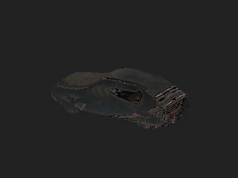

- Id: `covered_car`
- What: Covered abandoned car.
- Where: kerb, carriageway, sidewalk, yard, empty lot, plaza.
- Size: 4.35 × 1.75 × 1.35 m, 1780 triangles.
- Licence: CC0, Poly Haven.

### rusted wheel rim 02

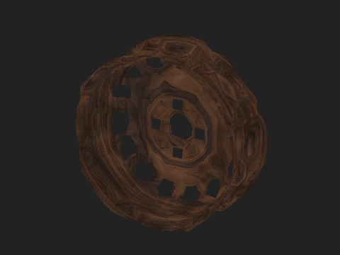

- Id: `rusted_wheel_rim_02`
- What: Loose rusted wheel rim.
- Where: kerb, carriageway, sidewalk, courtyard, yard, empty lot, plaza, park.
- Size: 0.33 × 0.12 × 0.33 m, 1666 triangles.
- Licence: CC0, Poly Haven.

### old tyre

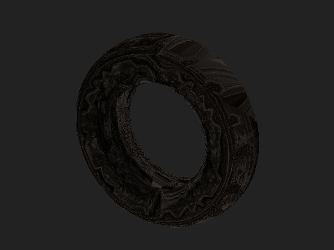

- Id: `old_tyre`
- What: Old tyre.
- Where: kerb, carriageway, sidewalk, courtyard, yard, empty lot, plaza, park.
- Size: 0.60 × 0.17 × 0.60 m, 1800 triangles.
- Licence: CC0, Poly Haven.

### 1969 ford mustang boss 429

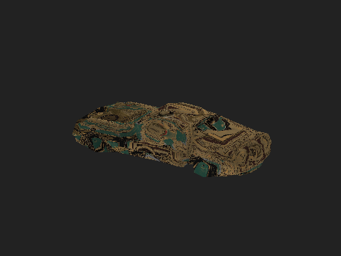

- Id: `mustang_boss_429`
- What: Abandoned muscle car.
- Where: kerb, carriageway, sidewalk, yard, empty lot, plaza.
- Size: 0.96 × 0.37 × 0.24 m, 1794 triangles.
- Licence: CC BY 4.0, mohamedhussien.
- When placed, `fit` scales it to 4.50 × 1.75 × 1.14 m.

### Rusty Abandoned Truck with Interior - Game Ready

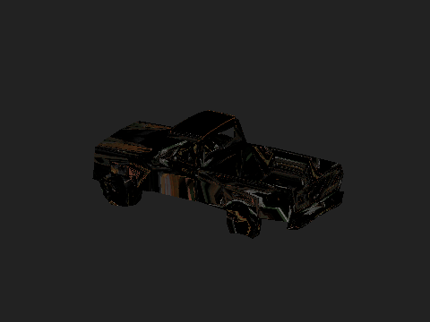

- Id: `rusty_abandoned_truck`
- What: Rusty truck.
- Where: kerb, carriageway, sidewalk, yard, empty lot, plaza.
- Size: 30.71 × 13.70 × 11.36 m, 1792 triangles.
- Licence: CC BY 4.0, rashad-brahimli.
- When placed, `fit` scales it to 4.50 × 2.01 × 1.66 m.

### Abandoned Auto Post-apocalyptic

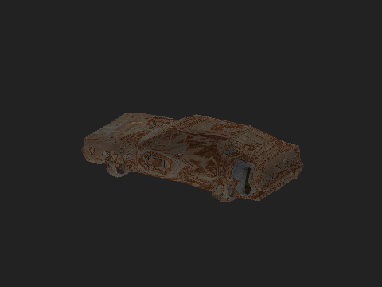

- Id: `abandoned_auto`
- What: Abandoned car.
- Where: kerb, carriageway, sidewalk, yard, empty lot, plaza.
- Size: 0.51 × 0.21 × 0.14 m, 1742 triangles.
- Licence: CC BY 4.0, pixeledbun.
- When placed, `fit` scales it to 4.50 × 1.86 × 1.26 m.

### Destroyed Car 03 / Backrooms Car (Gameready ver)

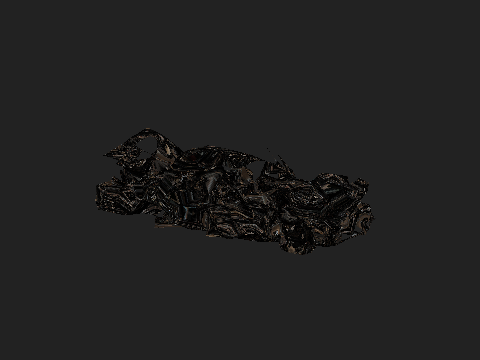

- Id: `destroyed_car_03`
- What: Destroyed sedan.
- Where: kerb, carriageway, sidewalk, yard, empty lot, plaza.
- Size: 3.10 × 1.57 × 0.92 m, 1799 triangles.
- Licence: CC BY 4.0, kryik1023.
- When placed, `fit` scales it to 4.50 × 2.29 × 1.33 m.

### Free Burned Police Cars

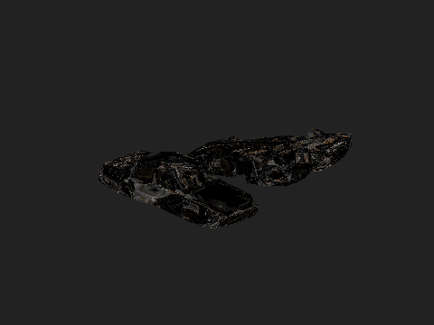

- Id: `burned_police_cars`
- What: Burned police car.
- Where: kerb, carriageway, sidewalk, yard, empty lot, plaza.
- Size: 0.68 × 0.58 × 0.19 m, 1791 triangles.
- Licence: CC BY 4.0, kryik1023.
- When placed, `fit` scales it to 4.68 × 4.00 × 1.28 m.

### Abandoned Generic Sedan 2 - Game Ready

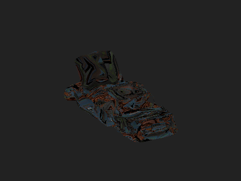

- Id: `abandoned_sedan_2`
- What: Abandoned sedan.
- Where: kerb, carriageway, sidewalk, yard, empty lot, plaza.
- Size: 49.36 × 35.91 × 16.95 m, 1798 triangles.
- Licence: CC BY 4.0, rashad-brahimli.
- When placed, `fit` scales it to 3.30 × 2.40 × 1.13 m.

### Crashed Abandoned Car - Game Ready

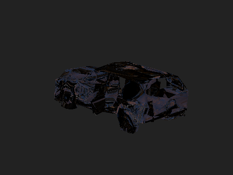

- Id: `crashed_abandoned_car`
- What: Crashed car.
- Where: kerb, carriageway, sidewalk, yard, empty lot, plaza.
- Size: 7.39 × 4.96 × 2.76 m, 1799 triangles.
- Licence: CC BY 4.0, rashad-brahimli.
- When placed, `fit` scales it to 3.57 × 2.40 × 1.34 m.

### Abandoned Generic Sedan 1 - Game Ready

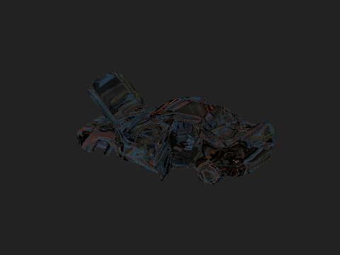

- Id: `abandoned_sedan_1`
- What: Abandoned sedan.
- Where: kerb, carriageway, sidewalk, yard, empty lot, plaza.
- Size: 21.18 × 12.16 × 7.30 m, 1797 triangles.
- Licence: CC BY 4.0, rashad-brahimli.
- When placed, `fit` scales it to 4.18 × 2.40 × 1.44 m.

### Crashed helicopter

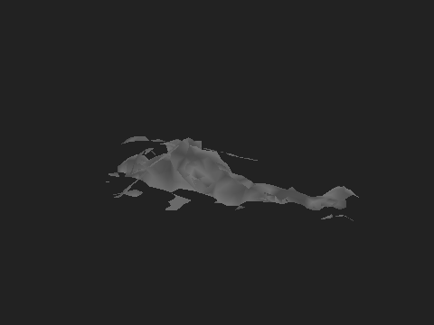

- Id: `crashed_helicopter`
- What: Crashed helicopter.
- Where: kerb, carriageway, courtyard, yard, empty lot, plaza, park.
- Size: 14.73 × 9.35 × 2.71 m, 1795 triangles.
- Licence: CC BY 4.0, jigar6102021.
- When placed, `fit` scales it to 6.30 × 4.00 × 1.16 m.

### Gas Tanker 14 MB

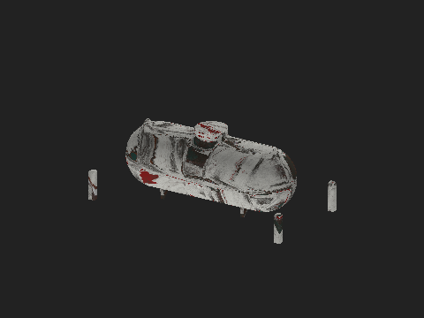

- Id: `gas_tanker`
- What: Stationary bulk gas tank on short legs, not a vehicle. Catalogued as `structures` / `tank` since 2026-10-30 (it was a `wreck`).
- Where: block edge, yard, empty lot, plaza.
- Size: 4.76 × 2.28 × 1.77 m, 1797 triangles.
- Licence: CC BY 4.0, ahmagh2e.

## Structures

### large iron gate

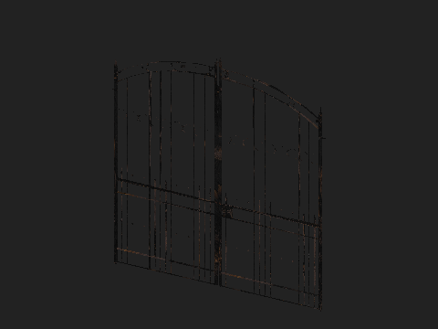

- Id: `large_iron_gate`
- What: Iron gate.
- Where: block edge, carriageway.
- Size: 2.93 × 0.06 × 2.91 m, 1384 triangles.
- Licence: CC0, Poly Haven.

### Building | Container | Metal

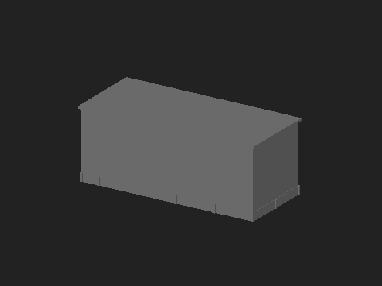

- Id: `building_container_metal`
- What: Building made of a metal container.
- Where: block edge, kerb, yard, empty lot, plaza, park.
- Size: 14.30 × 6.66 × 5.68 m, 920 triangles.
- Licence: CC BY 4.0, yadrogames.
### Forest Hut GameReady

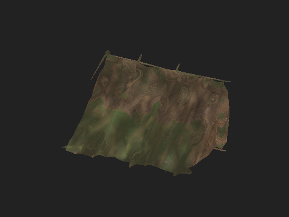

- Id: `forest_hut`
- What: Hut.
- Where: block edge, kerb, yard, empty lot, plaza, park.
- Size: 2.87 × 1.84 × 1.56 m, 1799 triangles.
- Licence: CC BY 4.0, Gerhald.

### Abandoned Garage Block Rusty Ruined Game-Ready

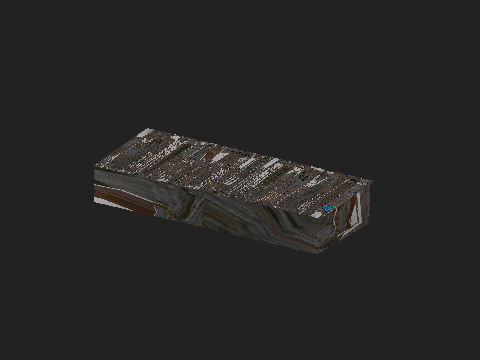

- Id: `abandoned_garage`
- What: Abandoned garage.
- Where: block edge, kerb, yard, empty lot, plaza, park.
- Size: 16.26 × 7.74 × 2.80 m, 1755 triangles.
- Licence: CC BY 4.0, olegolegperepelica.

### Watchtower

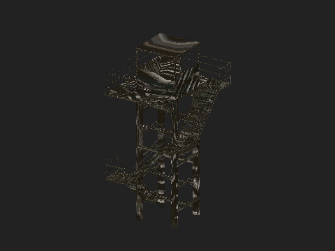

- Id: `watchtower`
- What: Watchtower.
- Where: block edge, kerb, yard, empty lot, plaza, park.
- Size: 0.15 × 0.15 × 0.30 m, 1764 triangles.
- Licence: CC BY 4.0, ahmagh2e.
- Not placed: the manifest marks it `refused: unknown_scale`.

### fence Door Metal protection-2PART 40MB

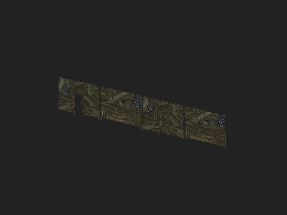

- Id: `fence_door_metal`
- What: Metal fence door.
- Where: block edge, carriageway.
- Size: 20.95 × 0.85 × 3.94 m, 1789 triangles.
- Licence: CC BY 4.0, ahmagh2e.

## Facade

A wall-mounted prop's back stays 0.08 m off its wall, whether the ambient dressing (`overgrow/dressing.py`) or a planned action (`overgrow/realize.py`) places it. The dressing's facade spot stands 0.35 m out so its point never falls inside the footprint; the prop is pulled back from that spot to the wall. Before this, the dressing added the two offsets and every aircon, camera and awning on MurciaEjemplo hung 0.38–0.44 m off the wall. The base height comes from `FACADE_Z_M` (`overgrow/catalog.py`): aircon 2.4 m, awning 2.5 m (above a 2.4 m door), camera 3.1 m, fire escape on the ground, any other role 1.2 m. The awnings used to take the 1.2 m default and hung at waist height. No wall-mounted prop may cover a shop sign `detail` hung (`facade.shops[].sign`, a fascia along its wall or a blade out of it, its footprint 0.05 m deeper on each side): when their footprints cross and their heights overlap the spot is rejected as `covers_sign`, and `overgrow fit` refuses one that does. On MurciaEjemplo2, madridescaleras2, barriochino and murciaescaleras placed again, no awning covered a sign before the rule either; nothing stopped one.

### modular fire escape

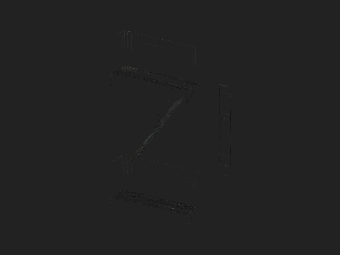

- Id: `modular_fire_escape`
- What: Fire escape against a wall.
- Where: facade.
- Size: 6.66 × 1.40 × 9.75 m, 1657 triangles.
- Licence: CC0, Poly Haven.

### exterior aircon unit

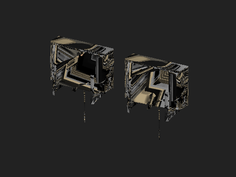

- Id: `exterior_aircon_unit`
- What: Facade air-conditioning unit.
- Where: facade.
- Size: 1.78 × 0.36 × 0.92 m, 1797 triangles.
- Licence: CC0, Poly Haven.

### security camera 02

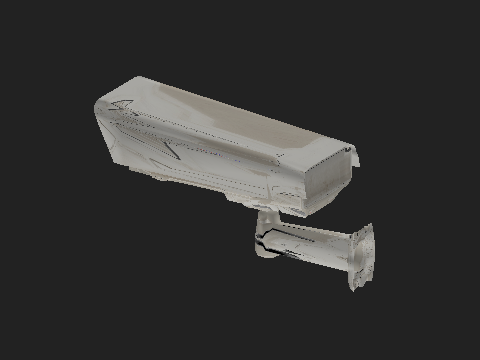

- Id: `security_camera_02`
- What: Security camera.
- Where: facade.
- Size: 0.39 × 0.14 × 0.21 m, 1750 triangles.
- Licence: CC0, Poly Haven.

### security camera 01

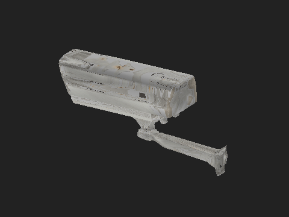

- Id: `security_camera_01`
- What: Security camera.
- Where: facade.
- Size: 0.55 × 0.17 × 0.28 m, 1748 triangles.
- Licence: CC0, Poly Haven.

### Fire Escape

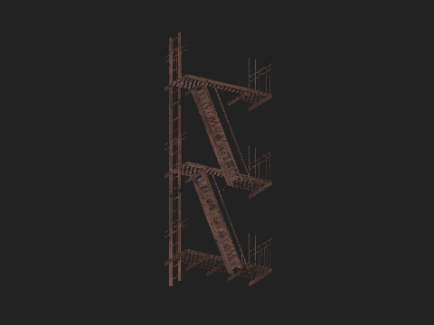

- Id: `fire_escape_sf`
- What: Fire escape.
- Where: facade.
- Size: 4.22 × 1.78 × 10.92 m, 1716 triangles.
- Licence: CC BY 4.0, local.yany.
- When placed, `fit` scales it to 3.78 × 1.60 × 9.78 m.

## Waste

### metal trash can

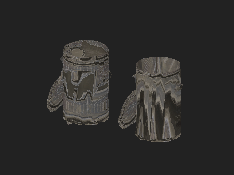

- Id: `metal_trash_can`
- What: Metal trash can.
- Where: kerb, carriageway, sidewalk, courtyard, yard, empty lot, plaza.
- Size: 1.76 × 0.54 × 0.91 m, 1796 triangles.
- Licence: CC0, Poly Haven.

### Barrel 01

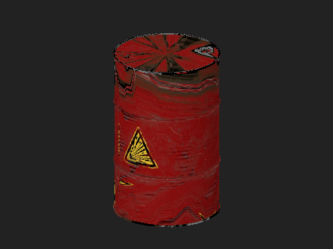

- Id: `Barrel_01`
- What: Barrel.
- Where: kerb, carriageway, sidewalk, courtyard, yard, empty lot, plaza.
- Size: 0.56 × 0.56 × 0.88 m, 1700 triangles.
- Licence: CC0, Poly Haven.

### barrel stove

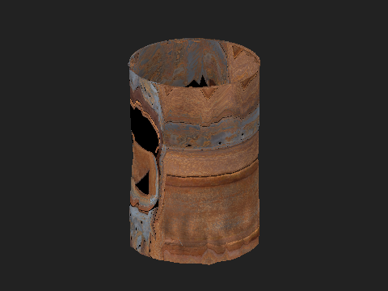

- Id: `barrel_stove`
- What: Barrel used as a stove.
- Where: kerb, carriageway, sidewalk, courtyard, yard, empty lot, plaza.
- Size: 0.58 × 0.58 × 0.85 m, 1732 triangles.
- Licence: CC0, Poly Haven.

### Barrel 02

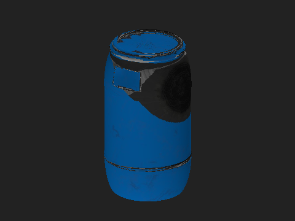

- Id: `Barrel_02`
- What: Barrel.
- Where: kerb, carriageway, sidewalk, courtyard, yard, empty lot, plaza.
- Size: 0.49 × 0.48 × 0.88 m, 1736 triangles.
- Licence: CC0, Poly Haven.

### can rusted

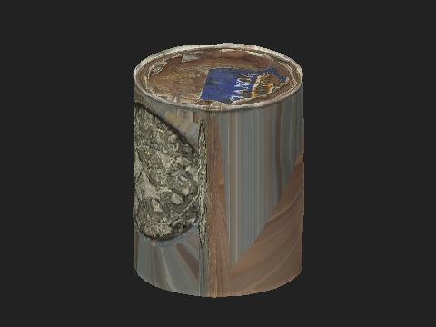

- Id: `can_rusted`
- What: Rusted can.
- Where: kerb, carriageway, sidewalk, courtyard, yard, empty lot, plaza.
- Size: 0.12 × 0.12 × 0.15 m, 1800 triangles.
- Licence: CC0, Poly Haven.

### small lpg tank

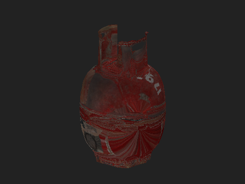

- Id: `small_lpg_tank`
- What: Gas cylinder.
- Where: kerb, carriageway, sidewalk, courtyard, yard, empty lot, plaza.
- Size: 0.41 × 0.40 × 0.63 m, 1798 triangles.
- Licence: CC0, Poly Haven.

### propane tank

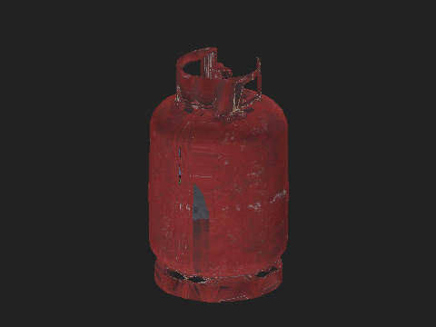

- Id: `propane_tank`
- What: Propane tank.
- Where: kerb, carriageway, sidewalk, courtyard, yard, empty lot, plaza.
- Size: 0.33 × 0.33 × 0.55 m, 1792 triangles.
- Licence: CC0, Poly Haven.

## Furniture

### industrial storage cart

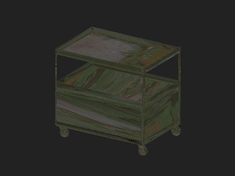

- Id: `industrial_storage_cart`
- What: Storage cart.
- Where: kerb, sidewalk, courtyard, yard, empty lot, plaza, park, carriageway.
- Size: 1.58 × 1.09 × 1.37 m, 1758 triangles.
- Licence: CC0, Poly Haven.

### old bed frame

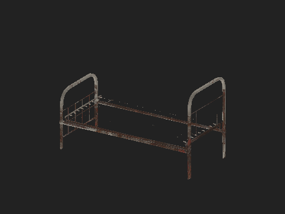

- Id: `old_bed_frame`
- What: Old bed frame.
- Where: kerb, sidewalk, courtyard, yard, empty lot, plaza, park.
- Size: 1.99 × 0.90 × 1.18 m, 1738 triangles.
- Licence: CC0, Poly Haven.

### wooden picnic table

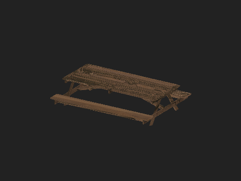

- Id: `wooden_picnic_table`
- What: Wooden picnic table.
- Where: kerb, sidewalk, courtyard, yard, empty lot, plaza, park.
- Size: 3.02 × 2.23 × 0.74 m, 1732 triangles.
- Licence: CC0, Poly Haven.

## Barriers

### concrete road barrier

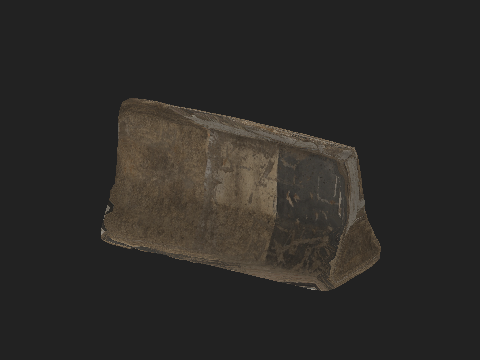

- Id: `concrete_road_barrier`
- What: Concrete barrier.
- Where: kerb, carriageway, sidewalk, plaza.
- Size: 1.54 × 0.62 × 0.81 m, 1796 triangles.
- Licence: CC0, Poly Haven.

### concrete road barrier 02

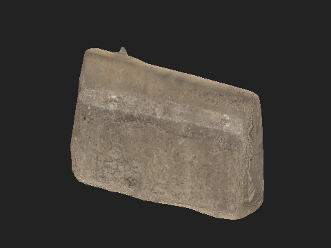

- Id: `concrete_road_barrier_02`
- What: Concrete barrier.
- Where: kerb, carriageway, sidewalk, plaza.
- Size: 1.56 × 0.43 × 1.10 m, 1796 triangles.
- Licence: CC0, Poly Haven.

### water manhole cover

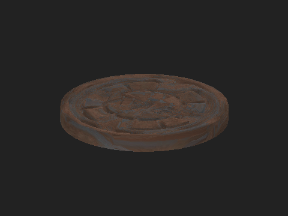

- Id: `water_manhole_cover`
- What: Manhole cover.
- Where: carriageway.
- Size: 0.69 × 0.69 × 0.07 m, 1796 triangles.
- Licence: CC0, Poly Haven.

### Low Poly Road Closed Barrier - Game Ready

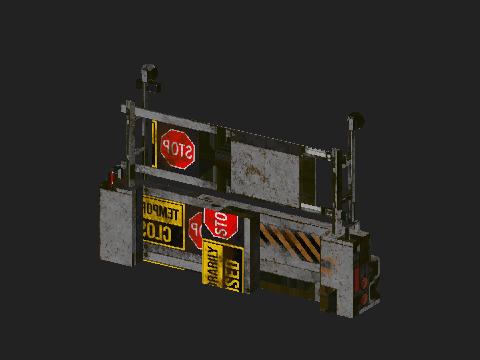

- Id: `road_closed_barrier`
- What: Road-closed barrier.
- Where: kerb, carriageway, sidewalk, plaza.
- Size: 6.22 × 1.13 × 4.15 m, 656 triangles.
- Licence: CC BY 4.0, rashad-brahimli.

### Barrier

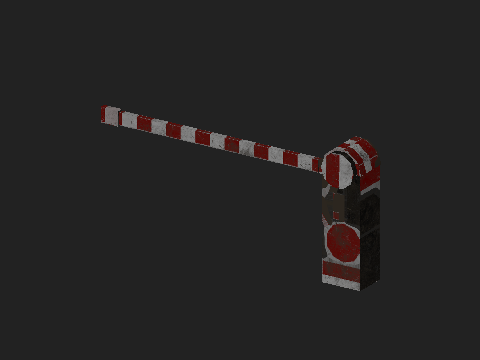

- Id: `barrier_low`
- What: Low barrier.
- Where: kerb, carriageway, sidewalk, plaza.
- Size: 2.90 × 0.43 × 1.41 m, 116 triangles.
- Licence: CC BY 4.0, tridentcorp.

### Warning Signboard

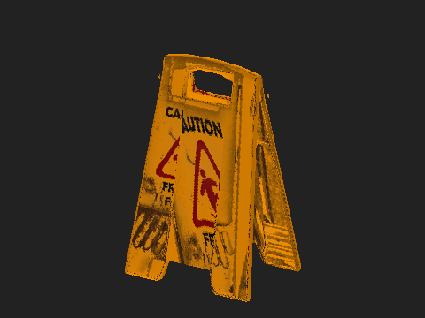

- Id: `warning_signboard`
- What: Warning sign.
- Where: kerb, carriageway, sidewalk, plaza.
- Size: 0.24 × 0.17 × 0.38 m, 1798 triangles.
- Licence: CC BY 4.0, chenkl.
- Not placed: the manifest marks it `refused: unknown_scale`.

## Vegetation

### fern 02

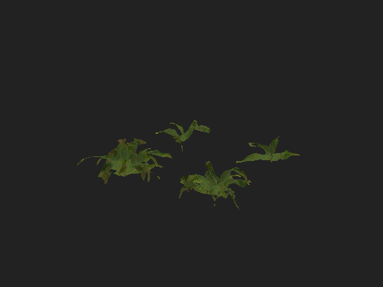

- Id: `fern_02`
- What: Fern.
- Where: sidewalk, yard, empty lot.
- Size: 1.95 × 1.71 × 0.41 m, 1788 triangles.
- Licence: CC0, Poly Haven.

### flower empodium

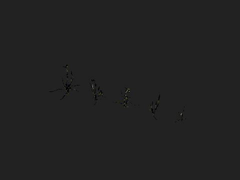

- Id: `flower_empodium`
- What: Small flowers.
- Where: sidewalk, yard, empty lot.
- Size: 1.32 × 0.28 × 0.27 m, 1793 triangles.
- Licence: CC0, Poly Haven.

### weed plant 02

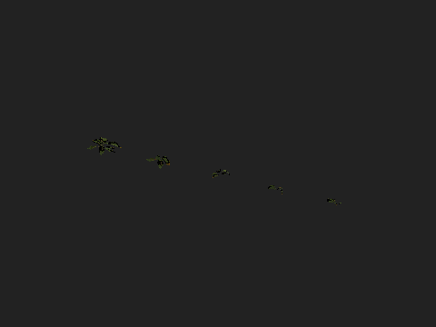

- Id: `weed_plant_02`
- What: Weed.
- Where: sidewalk, yard, empty lot.
- Size: 2.12 × 0.29 × 0.07 m, 1787 triangles.
- Licence: CC0, Poly Haven.

### shrub 03

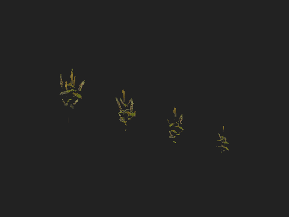

- Id: `shrub_03`
- What: Four thin upright weed stems in a line, not a bush. Catalogued as a `plant` since 2026-10-30 (it was a `bush`).
- Where: sidewalk, yard, empty lot.
- Size: 1.37 × 0.14 × 0.40 m, 1780 triangles.
- Licence: CC0, Poly Haven.
### Jungle Ground Roots With Leaf And Grass

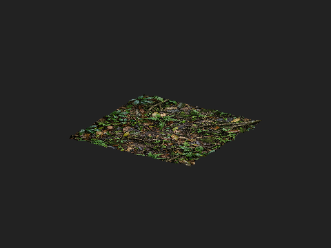

- Id: `jungle_ground_roots`
- What: Ground patch with roots.
- Where: yard, empty lot.
- Size: 1.98 × 1.98 × 0.06 m, 1769 triangles.
- Licence: CC BY 4.0, iGauravRajput.

### Jungle Ground with Water 3d model free

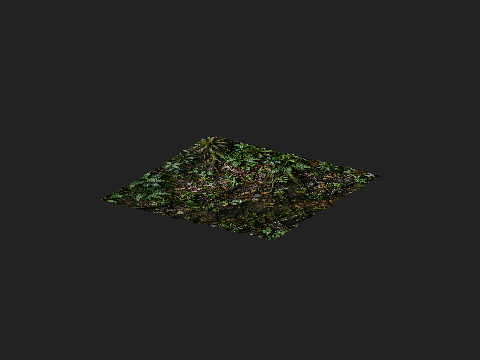

- Id: `jungle_ground_water`
- What: Wet ground patch.
- Where: yard, empty lot.
- Size: 1.95 × 1.97 × 0.05 m, 1739 triangles.
- Licence: CC BY 4.0, iGauravRajput.

### Jungle Ground 2 tailable sides 3d model

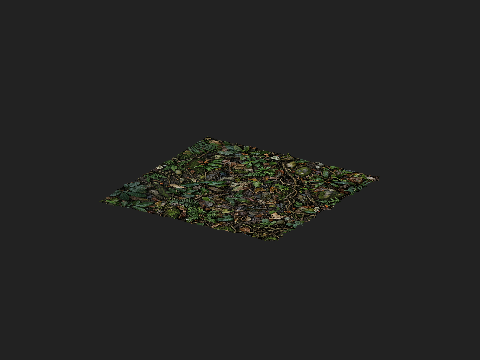

- Id: `jungle_ground_tile`
- What: Tileable vegetation ground.
- Where: yard, empty lot.
- Size: 1.97 × 1.95 × 0.06 m, 1784 triangles.
- Licence: CC BY 4.0, iGauravRajput.

### Tree low poly lowpoly

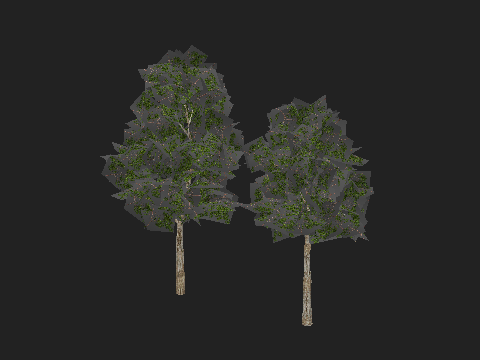

- Id: `tree_low_poly`
- What: Low-poly tree.
- Where: park, plaza, sidewalk, courtyard, yard, empty lot.
- Size: 10.73 × 5.21 × 8.99 m, 1629 triangles.
- Licence: CC BY 4.0, 00amza.

### Scanned Plants and Grass (Free Download)

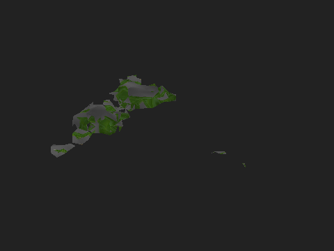

- Id: `scanned_plants_grass`
- What: Scanned plants and grass.
- Where: sidewalk, yard, empty lot.
- Size: 14.16 × 13.41 × 1.74 m, 1782 triangles.
- Licence: CC BY 4.0, klessgyzen.
